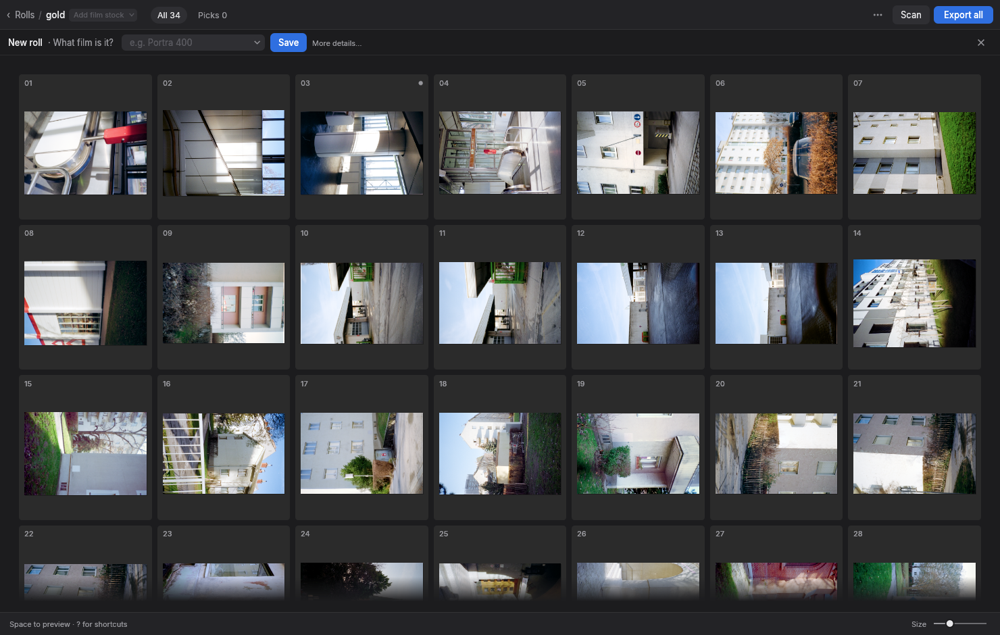
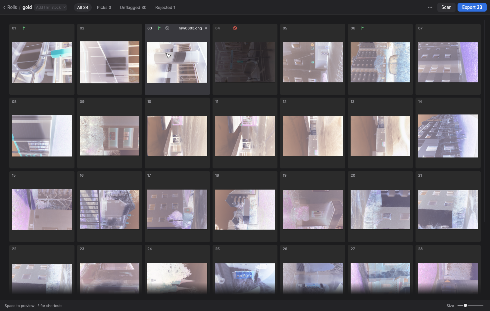
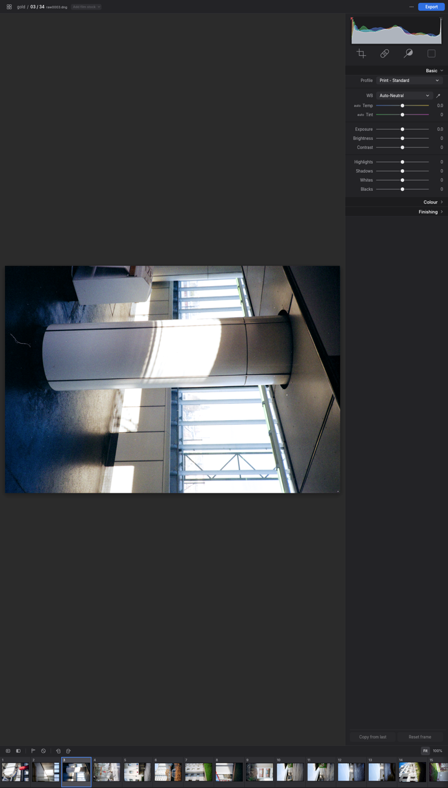
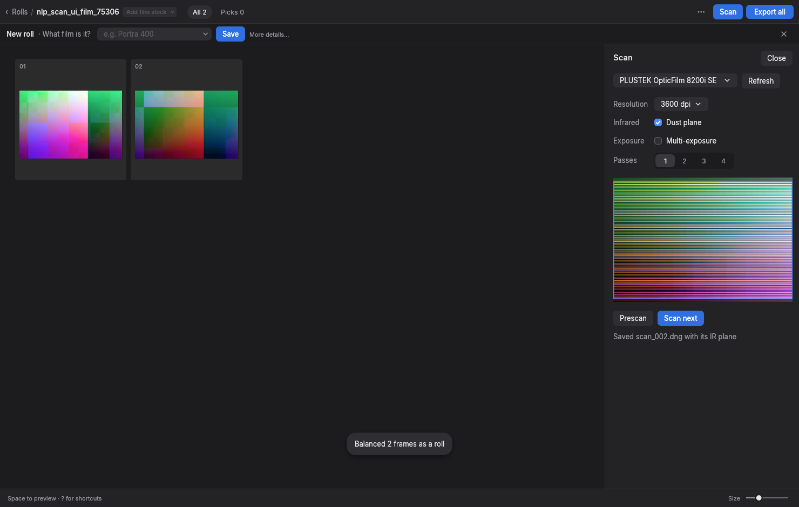

# Bresson

**Scan, convert and manage film negatives in one fast native app.**

Bresson turns camera scans and film-scanner output into finished positives. It reads RAW negatives (a camera pointed at a light table), TIFF/JPEG/PNG scans and scanner DNGs, or scans film itself from Plustek OpticFilm scanners and SANE flatbeds. A density-based print engine converts each frame, and you edit, cull and export from a Lightroom-style interface. There is also a headless CLI for batch work.

It is a single cross-platform Rust binary: no Lightroom, no catalog database, no subscription. Edits live in small human-readable JSON sidecars next to your scans, so a roll folder stays portable.



## Why it exists

Film photographers digitise rolls, not single images. Generic photo editors treat a scan as a digital photo; Bresson treats it as a negative that belongs to a roll.

- **Density-based conversion.** A scan becomes per-channel density above the film base, and that density is printed onto a paper curve, the way a lab print is made. Neutrals stay neutral from shadows to highlights; the film's crossover and dye crosstalk are modelled rather than fought with sliders.
- **Roll-aware.** Frames are analysed together. *Lab* mode gives each frame its own colour and density, like a lab scanner. *Darkroom* mode prints the whole roll at one setting. Roll info (film stock, ISO, push/pull, lab, developer) is shared across frames and ends up in EXIF and file names.
- **Automatic frame prep.** Film rebate and holder are detected and trimmed; frames are cropped and straightened for you. Unconverted frames convert automatically when a folder opens.
- **Scan straight into a roll.** Native Rust driver for Plustek OpticFilm scanners (no vendor software) and SANE support for flatbeds with a transparency unit.
- **Non-destructive and open.** Settings go to `NLP/<file>.nlp.json`, roll metadata to `NLP/roll.json`.

## Tour

### Rolls and the grid

The start screen lists your rolls with a mosaic of three frames each. Opening one shows a uniform grid with pick / reject flags (`P` / `X` / `U`), filters (All, Picks, Unflagged, Rejected), box selection, and a Space quick look. Export and the contact sheet act on the selection, or on the frames on show.

Hold `N` to see the raw negatives behind the grid:



### Editor

A single-frame editor with a histogram / curves panel, tone profile, white balance (presets, neutral eyedropper, temperature and tint), exposure and tone sliders, colour toning and looks, before / after and split views, and a clipping overlay. A filmstrip runs along the bottom.

Tools: **Crop & Straighten** (aspect lock, level line, auto frame detection), **Heal** (dust and scratch spots, Lightroom-style), and **Dodge & Burn** (a local print-time brush).



### Scanning

**Scan** in a roll's top bar opens the scan panel beside the grid. Prescan the holder or bed, frame the shot (one box for a film scanner, one per frame on a flatbed), and scan. Each frame is saved as a linear DNG in the roll folder, joins the grid, and converts with the roll. OpticFilm infrared dust planes are kept alongside. A simulated scanner is built into debug builds, so you can try the panel without hardware.



### Export

Positives as TIFF (8/16-bit) or JPEG in sRGB, AdobeRGB or ProPhoto, with an embedded ICC profile and EXIF, optional HDR gain-map JPEGs, presets, size limits and a file-name template. A contact sheet JPEG of a roll is one click.

## Install and run

You need a recent stable [Rust toolchain](https://rustup.rs).

```bash
cargo run --release                      # GUI, starting on the Rolls list
cargo run --release -- /path/to/scans    # GUI on a folder or single file
cargo run --release -- help
```

SANE scanners need `libsane` (`brew install sane-backends` on macOS, or your distribution's `sane-backends`); the app runs fine without it. Try the Scan panel with simulated scanners:

```bash
NLP_FAKE_SCANNERS=1 cargo run --release -- /path/to/roll
```

## Command line

```bash
cargo run --release -- convert [--roll] [--roll-process NAME] [--tone NAME] [--wb NAME] \
    [--lut NAME] [--auto-crop] [--aspect NAME] [--flat FILE] [--jpg] [--hdr] \
    [--long-edge PX] [--name TEMPLATE] [--out DIR] FILES
cargo run --release -- scan-prep FILES     # gamma-encode linear TIF scans
cargo run --release -- synth [out.tif] [ev]  # write the modelled ColorChecker negative
```

- `--roll` analyses the files together (2+ frames); `--roll-process` is `Lab` (default) or `Darkroom`.
- `--auto-crop` crops and straightens to the detected frame, in the shape given by `--aspect` (Original, Free, 1:1, 2:3, 4:5, …).
- `--flat` divides out uneven light with a flat-field frame.
- `--name` takes the export file-name template (`{name}`, `{n:03}`, `{stock}`, `{iso}`, `{date}`).

## Keyboard

Press `?` in the app for the full shortcut sheet. A few to start: `Enter` opens a frame, `Space` quick-looks, `P` / `X` / `U` flag, `C` crop, `Q` heal, `K` dodge & burn, `B` before / after, `J` clipping, `⌘Z` undo.

## How the conversion works

For each frame: decode to linear RGB, find the film base, convert to density, remove dye crosstalk, analyse levels on a 600 px proxy (neutral-axis fit, crossover bend, skin-aware midtone), then print through a tone profile with white-balance filtration, looks and an output colour space. The roll supplies the film's properties; Lab mode fades each frame towards the roll balance as its own confidence drops.

Conversion quality is measured on a physically modelled ColorChecker negative (`testchart.rs`) and on real rolls. See [docs/conversion-engine.md](docs/conversion-engine.md) for the stage-by-stage walkthrough.

## Repository layout

| Path | Contents |
|---|---|
| `src/engine/` | Pure image processing: decode, density, analysis, print engine, looks, export |
| `src/app/` | The eframe / egui GUI: rolls, grid, editor, scan panel, GPU preview |
| `src/cli.rs` | The `convert`, `scan-prep` and `synth` commands |
| `scanners/opticfilm` | Plustek OpticFilm driver: a parity-tested Rust port of pyopticfilm (GPL-3) |
| `scanners/sane` | SANE bindings (libsane loaded at runtime) and a simulated flatbed |
| `crosstalk/` | Film dye crosstalk matrices (see its README) |
| `docs/` | Engine documentation |

## Tests

```bash
cargo test --release                        # engine + app, including conversion quality metrics
cargo test --release chart_quality -- --nocapture
cargo test -p opticfilm --release           # driver parity with pyopticfilm
cargo test -p sane --release                # SANE layer against its simulated flatbed
```

Headless UI screenshots (what this README's pictures come from):

```bash
NLP_UI_TEST_DIR=<scans> NLP_UI_OUT=<dir> cargo test --release ux_tour -- --ignored
NLP_UI_TEST_DIR=<scans> NLP_UI_OUT=<dir> cargo test --release grid_tour -- --ignored
NLP_UI_OUT=<dir> cargo test --release scan_panel
```

## Status and licence

Scanning has been validated against mock and simulated scanners (and real libsane's `test` backend) but has not yet run on real hardware. Linking the GPL-3 OpticFilm driver makes distributed builds GPL-3. Film crosstalk data comes from NegPy (GPL-3, personal use).
