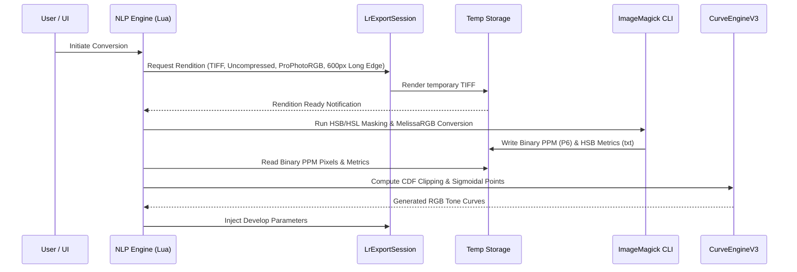
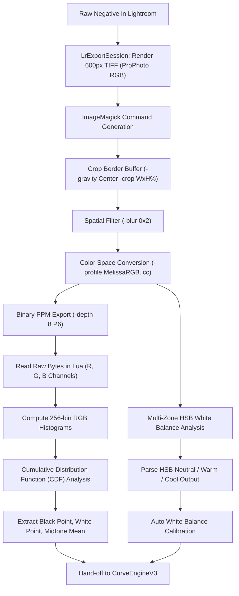
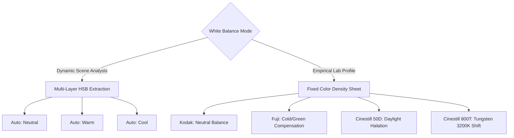
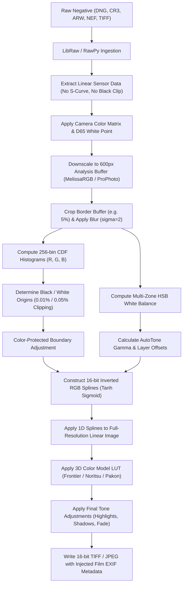

# Technical Specification: Negative Conversion Plugin (NLP) Architecture & Inversion Engine

**Document Version:** 3.1.1-REV  
**Target Architecture:** Adobe Lightroom Classic Plugin SDK (v6.0+) / Standalone CLI Implementation  
**Source Codebase:** Negative Conversion Plugin v3.1.1  
**Author:** Antigravity Engineering (Deconstruction & Deep Codebase Audit)  

---

## Table of Contents
1. [Executive Summary & Core Engineering Principles](#1-executive-summary--core-engineering-principles)
2. [Lightroom Classic Architecture & SDK Subversion](#2-lightroom-classic-architecture--sdk-subversion)
   - 2.1 The Lightroom Sandbox Problem
   - 2.2 The Micro-Rendition Pipeline (`LrExportSession`)
   - 2.3 Real-Time Interactivity Engine (`LrDevelopController` vs Catalog Write Access)
   - 2.4 Multi-Pass Correction Architecture (`MaskGroupBasedCorrections`)
3. [The Adobe Camera Raw (ACR) Asset Ecosystem](#3-the-adobe-camera-raw-acr-asset-ecosystem)
   - 3.1 Custom Camera Profiles (`.dcp`) Architecture
   - 3.2 Enhanced Creative Profiles (`.xmp`) & 3D LUT Base85 Encoding
   - 3.3 MelissaRGB & Working Color Spaces
4. [Image Ingestion, Sampling & Pre-Analysis Pipeline (`NLPImageProcessorV3.lua`)](#4-image-ingestion-sampling--pre-analysis-pipeline-nlpimageprocessorv3lua)
   - 4.1 Rendition Generation & Parameter Negotiation
   - 4.2 ImageMagick Multi-Stage Extraction & Border Buffer
   - 4.3 Multi-Zone White Balance HSB/HSL Analysis
   - 4.4 Binary PPM Parser (P6 RGB / P5 Grayscale)
   - 4.5 Cumulative Distribution Function (CDF) Histogram Clipping
5. [Mathematical Curve Engine & Inversion Pipeline (`CurveEngineV3.lua`)](#5-mathematical-curve-engine--inversion-pipeline-curveenginev3lua)
   - 5.1 Inversion Coordinate Mechanics
   - 5.2 AutoTone Gamma Midpoint Derivation
   - 5.3 Hyperbolic Tangent Sigmoidal Modeling
   - 5.4 Inverted Sigmoid Implementation (`atanh`)
   - 5.5 Layered Parametric Curve Pipeline
   - 5.6 Color-Protected Clipping Algorithms
   - 5.7 ToneCurvePV2012 Array Serialization
6. [Color Science, White Balance & Film Emulation (`NLPColorV3.lua`, `NegativePresets.lua`)](#6-color-science-white-balance--film-emulation-nlpcolorv3lua-negativepresetslua)
   - 6.1 Orange Film Mask Physics & Subtraction
   - 6.2 White Balance Modes: Dynamic Scene vs Empirical Film Calibration
   - 6.3 Scanner & Lab Color Models
   - 6.4 Color Space Matrices & Transformations
7. [Roll Dynamics & Frame Synchronization (`NLPRolls.lua`, `NLPSessionV3.lua`)](#7-roll-dynamics--frame-synchronization-nlprollslua-nlpsessionv3lua)
   - 7.1 Roll Aggregation & Origin Calculation
   - 7.2 Scene Matching & Outlier Rejection
8. [Positive Copy Baking & Scanner Prep Utilities](#8-positive-copy-baking--scanner-prep-utilities)
   - 8.1 Positive Copy Pipeline (`NLPExportServiceProviderV3.lua`)
   - 8.2 EXIF / IPTC / XMP Film Metadata Injection (`ExifV3.lua`)
   - 8.3 Flatbed TIFF Prep Normalization (`GammaUtilityV3.lua`)
   - 8.4 Scanner DNG Profile Unlocking (`UpdateDNGV3.lua`)
9. [Exhaustive File-by-File Codebase Audit](#9-exhaustive-file-by-file-codebase-audit)
10. [Re-Implementation Blueprint: Standalone `NLP_CLI`](#10-re-implementation-blueprint-standalone-nlp_cli)

---

## 1. Executive Summary & Core Engineering Principles

Negative Conversion Plugin (NLP) is an advanced film negative inversion and color grading engine built to operate within the constraints of Adobe Lightroom Classic. Rather than behaving as an external raster image editor that bakes pixels destructively into intermediate TIFF or PSD files, NLP achieves **non-destructive, real-time raw inversion directly inside Lightroom's native Develop Module**.

### Core Technical Feat
Lightroom's internal RAW processing pipeline (Adobe Camera Raw / ACR) is fundamentally designed for positive sensor data:
$$\text{Sensor Photons} \propto \text{Digital Numbers (Linear DN)} \xrightarrow{\text{Tone Curve}} \text{Display Output}$$

Negative film records light inversely:
$$\text{Exposure } H \propto \text{Density } D \propto \log\left(\frac{1}{T}\right) \implies \text{Transmittance } T = 10^{-D}$$

Furthermore, color negative film (C-41 process) contains an integral orange mask composed of unexposed dye couplers (principally colored masking couplers in the magenta and cyan forming layers) designed to compensate for unwanted secondary spectral absorptions of the cyan and magenta dyes. 

NLP solves this through a four-part architecture:
1. **DCP Linearization & Black-Render Neutralization**: Custom Digital Camera Profiles (`.dcp`) strip Adobe's proprietary contrast curve and disable automatic black-crushing (`Default Black Render = None`), providing a linear baseline.
2. **Out-of-Process Micro-Rendition Analysis**: The plugin generates an ephemeral 600px (formerly 200px) ProPhotoRGB rendition via `LrExportSession`, processes it using bundled binary toolchains (`ImageMagick` and custom C/Lua parsers), and extracts statistical channel histograms and HSB scene metrics.
3. **Parametric Curve Inversion Engine**: Using hyperbolic tangent ($\tanh$) sigmoidal functions and CDF percentile clipping, NLP generates inverted parametric coordinate points `(x, y)` for Lightroom's per-channel 16-bit RGB tone curves (`ToneCurvePV2012Red`, `ToneCurvePV2012Green`, `ToneCurvePV2012Blue`).
4. **Adobe Enhanced Profile LUT Fusion**: Color models (Frontier, Noritsu, Pakon, Crystal) are implemented as Adobe Creative Look Profiles (`.xmp`) packaging 3D Look-Up Tables (`90x30x30` or `32x32x32` RGB tables) encoded in Adobe Base85 format.

---

## 2. Lightroom Classic Architecture & SDK Subversion

### 2.1 The Lightroom Sandbox Problem
The Adobe Lightroom SDK is deliberately restrictive:
- **No Direct Pixel Access**: Lua scripts running inside the Lightroom sandbox cannot inspect bitmap pixel buffers of photos loaded into the catalog.
- **No Native Negative Inversion Operator**: Adobe Camera Raw lacks a native "Invert" checkbox or negative exposure slider. Inverting the master parametric tone curve `(0, 255) -> (255, 0)` breaks all secondary Develop sliders (Exposure, Highlights, Shadows, Blacks, Whites behave in reverse and distort color balance).
- **Execution Latency**: Applying settings via the Catalog database (`photo:applyDevelopSettings`) incurs SQLite transaction overhead, making real-time slider manipulation impossible.

### 2.2 The Micro-Rendition Pipeline (`LrExportSession`)
To extract pixel data without stalling the host machine, NLP implements an ephemeral out-of-process rendition pipeline:



In `NLPImageProcessorV3.lua`:
- Export Format: `TIFF`
- Compression: `compressionMethod_None`
- Color Space: `ProPhotoRGB`
- Bit Depth: `8` (sufficient for statistical sampling)
- Long Edge Dimension: `600` px (in `processPhotoV3`; `200` px in legacy `processPhoto`)
- Metadata: Stripped (`LR_minimizeEmbeddedMetadata = true`)

Rendering a 600px uncompressed TIFF takes between 15ms and 45ms. Once rendered, `rendition:waitForRender()` returns and hands the path to the analysis pipeline.

### 2.3 Real-Time Interactivity Engine (`LrDevelopController` vs Catalog Write Access)
NLP achieves real-time interactive UI updates by differentiating between the current Lightroom module and session state:

In `NLPViewControllerV3.lua` (`applyLightroomSettings`):
```lua
if currentModule == "develop" and not delayWrite then
    for param, value in pairs(settingsTable) do
        LrDevelopController.setValue(param, value)
    end
else
    NLPViewController.applySettingsWithDelay(settingsTable, photo)
end
```

- **Develop Module Active**: Calls `LrDevelopController.setValue(param, value)`. This communicates directly with Lightroom's active GPU develop pipeline, bypassing disk I/O and SQLite catalog commits. The preview reflects changes within 16ms (60 FPS responsiveness).
- **Library Module / Batch Mode**: Wraps settings into `photo:applyDevelopSettings()` scheduled inside an asynchronous catalog transaction (`catalog:withWriteAccessDo`).

### 2.4 Multi-Pass Correction Architecture (`MaskGroupBasedCorrections`)
Lightroom Classic 11.0 introduced AI masking and group-based local corrections. NLP v3 takes advantage of this to implement **Multi-Pass Curve Correction** (`correctionType = "multiPass"`):

When `IsGroupMaskAvailable == true`:
1. **Pass 1 (Base Linearization & Inversion)**: The primary per-channel develop tone curves (`ToneCurvePV2012Red`, `ToneCurvePV2012Green`, `ToneCurvePV2012Blue`) invert the negative and neutralize the orange film base.
2. **Pass 2 (Color & Tonal Grading Mask)**: A full-frame mask group (`MaskGroupBasedCorrections`) is generated programmatically. Inside this mask, a second curve layer (`makeMaskCurve`) applies fine-tuned tonal shaping, contrast, highlight roll-off, and shadow toning without clipping the underlying base inversion.

---

## 3. The Adobe Camera Raw (ACR) Asset Ecosystem

### 3.1 Custom Camera Profiles (`.dcp`) Architecture
Negative Conversion Plugin bundles over 2,500 `.dcp` camera profiles located in `NLP Plugin/CameraRaw/CameraProfiles/NegativeLab Camera Profiles/`.

Inspecting `Negative Lab - Nikon D750 v2.3.dcp` reveals the exact profile specifications:
```
File Type                       : DCP (DNG Camera Profile)
Unique Camera Model             : Nikon D750
Color Matrix 1 (Std Light A)    : 1.0019 -0.4200 -0.0032 -0.4773 1.2481 0.2572 -0.0643 0.1409 0.8486
Color Matrix 2 (D65)            : 0.9020 -0.2890 -0.0715 -0.4535 1.2436 0.2348 -0.0934 0.1919 0.7086
Profile Calibration Sig         : com.adobe
Profile Name                    : Negative Lab v2.3
Profile Tone Curve              : 3,202 bytes custom curve
Profile Look Table Dims         : 90 30 30 (Hue x Saturation x Value)
Profile Look Table Encoding     : sRGB
Baseline Exposure Offset        : -0.350000000 EV
Default Black Render            : None
```

#### Why Standard Camera Profiles Fail:
1. **Adobe Standard S-Curve**: Standard Adobe profiles embed an aggressive contrast S-curve that boosts midtone contrast and clips the shadows of positive images. Applied to a film negative, this curve crushes the negative's highlights (positive shadows) into solid black and blows out negative shadows (positive highlights).
2. **Default Black Render**: Adobe ACR automatically applies dynamic black subtraction unless explicitly instructed otherwise. Setting `Default Black Render = None` forces Lightroom to output absolute sensor raw data down to zero.
3. **Look Table 90x30x30**: Embeds an 81,000-point 3D color lookup table that linearizes camera-specific sensor color filter array (CFA) variances before NLP's curve engine touches the data.
4. **Baseline Exposure Offset (-0.35 EV)**: Offsets the sensor input by -0.35 EV to provide headroom against digital white clipping on high-density negative borders.

### 3.2 Enhanced Creative Profiles (`.xmp`) & 3D LUT Base85 Encoding
The color models in NLP (Frontier, Noritsu, Pakon, Crystal) are Adobe Creative Profiles installed into `CameraRaw/Settings/NLP Enhanced Settings/`.

Excerpt from `Negative Lab v2.3 - Frontier.xmp`:
```xml
<rdf:Description rdf:about=""
    xmlns:crs="http://ns.adobe.com/camera-raw-settings/1.0/"
    crs:PresetType="Look"
    crs:UUID="5F20C698951E4393B80887826E91C467"
    crs:CameraProfile="Negative Lab v2.3"
    crs:CameraProfileDigest="A68F1489685F164505532B7C1B1401B0"
    crs:RGBTable="547893592CC94E1C2DCCF000F3A1D7DF"
    crs:Table_547893592CC94E1C2DCCF000F3A1D7DF="Lir00)KVtsA#*bo#fiOJ$X.pl... [228 KB Base85 Data]">
    <crs:Name>
        <rdf:Alt><rdf:li xml:lang="x-default">Negative Lab v2.3 - Frontier</rdf:li></rdf:Alt>
    </crs:Name>
</rdf:Description>
```

#### Mechanism:
- Adobe ACR supports 3D Color Lookup Tables stored inside `.xmp` files under `crs:Table_<UUID>`.
- The LUT data represents a 3D lattice in RGB space, compressed using Adobe's proprietary ASCII85/Base85 encoding.
- In `NegativePresets.lua`, NLP maintains an internal lookup table mapping profile names and saturation steps to exact MD5/UUID identifiers:
  ```lua
  enhanced_profile_tables["Negative Lab v2.3 - Frontier - Sat1"]  = "C6AB830B7635BF72531EBB3AEAB40050"
  enhanced_profile_tables["Negative Lab v2.3 - Frontier"]       = "547893592CC94E1C2DCCF000F3A1D7DF"
  enhanced_profile_tables["Negative Lab v2.3 - Frontier - Sat10"] = "EEC4023786E7DD7B314D1FC3B3BFFE20"
  ```
- When the user selects a Color Model and Saturation level in the UI, NLP updates Lightroom's `Look` property to the corresponding UUID, instantly applying the target 3D LUT on the GPU.

### 3.3 MelissaRGB & Working Color Spaces
Lightroom's internal Develop Module does not operate in standard sRGB, AdobeRGB, or ProPhotoRGB. It operates in **MelissaRGB**:
- **Primaries**: ProPhoto RGB (ROMM RGB)
- **White Point**: D65 (unlike standard ProPhoto RGB which uses D50)
- **Transfer Function (TRC)**: sRGB Tone Response Curve ($1 / 2.4$ with linear toe)

NLP bundles ICC profiles in `./profiles/`:
- `MelissaRGB.icc`
- `ProPhoto.icc`
- `sRGB.icc`

During analysis, ImageMagick transforms the exported ProPhoto rendition into MelissaRGB using absolute colorimetric rendering intent:
`-intent Absolute -profile /profiles/MelissaRGB.icc`
This guarantees that pixel values sampled by NLP exactly match the coordinate space of Lightroom's Develop tone curve engine.

---

## 4. Image Ingestion, Sampling & Pre-Analysis Pipeline (`NLPImageProcessorV3.lua`)



### 4.1 Rendition Generation & Parameter Negotiation
In `NLPImageProcessorV3.lua`, `processPhotoV3` configures the export session:
```lua
local exportSettings = {
    LR_export_destinationType = "specificFolder",
    LR_export_destinationPathPrefix = tempDir,
    LR_format = "TIFF",
    LRtiff_compressionMethod = "compressionMethod_None",
    LR_export_colorSpace = "ProPhotoRGB",
    LR_export_bitDepth = 8,
    LR_size_resizeType = "longEdge",
    LR_size_maxHeight = 600,
    LR_size_doConstrain = true,
    LR_size_doNotEnlarge = true,
    LR_minimizeEmbeddedMetadata = true
}
```

### 4.2 ImageMagick Multi-Stage Extraction & Border Buffer
The ImageMagick CLI command constructed in `L46_1` / `L47_1` performs multiple image transformations in a single call via memory-mapped caching (`mpr:original`):

1. **Border Buffer Cropping**:
   $$\text{Crop Percentage} = 100 - (2 \times \text{filmBorder})$$
   If `filmBorder = 5%`, crop size is $90\% \times 90\%$ centered:
   `-gravity Center -crop 90x90%+0+0 +repage`
   This excludes the unexposed film rebate/border from contaminating the image histogram.
2. **Spatial Blur Filter**:
   `-blur 0x2`
   Removes high-frequency film grain noise and half-tone artifacts, preventing rogue silver grains from skewing the histogram min/max endpoints.
3. **In-Memory Cache Creation**:
   `-write mpr:original +delete`

### 4.3 Multi-Zone White Balance HSB/HSL Analysis
NLP runs three separate color analysis passes over the cached image in memory to compute candidate white balance points:

```lua
-- Option 1: Neutral Multi-Zone Analysis
{
    hueLowThreshold = 0, hueHighThreshold = 100, invertHue = false,
    satThreshold = 70, luminosityLowThreshold = 0, luminosityHighThreshold = 100
}
-- Option 2: Warm-Biased Midtone Analysis
{
    hueLowThreshold = 40.28, hueHighThreshold = 75.0, invertHue = false,
    satThreshold = 60, luminosityLowThreshold = 25, luminosityHighThreshold = 75
}
-- Option 3: Cool-Biased Midtone Analysis
{
    hueLowThreshold = 25.0, hueHighThreshold = 75.0, invertHue = true,
    satThreshold = 70, luminosityLowThreshold = 25, luminosityHighThreshold = 75
}
```

For each option, ImageMagick constructs a compound mask isolating specific chromatic zones:
1. Converts clone to HSB colorspace and isolates the Hue channel:
   `-clone 1 -colorspace HSB -channel red -separate +channel -black-threshold X% -white-threshold Y% -fill black -opaque white -threshold 0`
2. Isolates Saturation channel and filters high-saturation objects:
   `-clone 1 -colorspace HSB -channel green -negate -separate +channel -threshold S%`
3. Multiplies Hue and Saturation masks:
   `-clone 2-3 -compose Multiply -composite`
4. Isolates Luminance channel in HSL colorspace:
   `-clone 1 -colorspace HSL -channel blue -separate +channel -black-threshold L_low% -white-threshold L_high% -fill black -opaque white`
5. Multiplies with the chrominance mask, applies as opacity mask, and scales to a single 1x1 average pixel:
   `-scale 1x1! -alpha off -colorspace HSB -depth 8 -format "%[pixel:u]\n" -write info:`

The resulting sampled HSB values are parsed in `L48_1` and stored in metadata:
- `autoWB.smartColorNeutral`: `{ h = round(h1), s = round(s1), b = round(b1) }`
- `autoWB.smartColorWarming`: `{ h = round(h2), s = round(s2), b = round(b2) }`
- `autoWB.smartColorCooling`: `{ h = round(h3), s = round(s3), b = round(b3) }`

### 4.4 Binary PPM Parser (P6 RGB / P5 Grayscale)
The analyzed image is written to disk as a binary Netpbm image (`.ppm`) in MelissaRGB space. In `L49_1` / `L51_1`:
- Reads header: confirms magic number `P6` (RGB binary) or `P5` (Grayscale binary), dimensions $(W, H)$, and maxval $255$.
- Slurps the binary raster stream (`read("*a")`).
- In `L51_1`, parses raw bytes into three 256-element frequency tables ($H_R, H_G, H_B$):
  ```lua
  for i = 1, #data - 3, 3 do
      local r = data:byte(i) + 1
      local g = data:byte(i + 1) + 1
      local b = data:byte(i + 2) + 1
      histR[r] = histR[r] + 1
      histG[g] = histG[g] + 1
      histB[b] = histB[b] + 1
  end
  ```

### 4.5 Cumulative Distribution Function (CDF) Histogram Clipping
In `L50_1`, NLP determines the true black and white clipping points for each channel using cumulative probability distribution thresholds defined in `NegativePresets.lua`:

| Image Type | Low Clip Threshold ($C_{\text{low}}$) | High Clip Threshold ($C_{\text{high}}$) |
|---|---|---|
| **Negative (Film)** | $0.0001$ ($0.01\%$) | $0.0005$ ($0.05\%$) |
| **Positive (Slide/Digital)** | $0.0001$ ($0.01\%$) | $0.0001$ ($0.01\%$) |
| **Edit Only** | $0.0000$ ($0.00\%$) | $0.0000$ ($0.00\%$) |

#### Algorithm:
1. **White Point Origin (Negative Minimum Density / Film Base)**:
   Scans forward from index $k = 1$ to $256$:
   $$\sum_{i=1}^{k} \frac{H_c[i]}{N_{\text{total}}} > C_{\text{low}} \implies \text{whitePointOrigin} = k - 1$$
2. **Black Point Origin (Negative Maximum Density / Heavy Silver Exposure)**:
   Scans backward from index $k = 256$ down to $1$:
   $$\sum_{i=256}^{k} \frac{H_c[i]}{N_{\text{total}}} > C_{\text{high}} \implies \text{blackPointOrigin} = k - 1$$
3. **Midtone Mean Calculation**:
   Trims $0.5\%$ from each boundary to exclude noise:
   $$k_{\text{start}} = \text{round}(\text{whitePointOrigin} \times 1.005)$$
   $$k_{\text{end}} = \text{round}(\text{blackPointOrigin} \times 0.995)$$
   Calculates the normalized weighted intensity mean $\mu_c$:
   $$\mu_c = \frac{1}{256} \cdot \frac{\sum_{i=k_{\text{start}}}^{k_{\text{end}}} H_c[i] \cdot (i - k_{\text{start}}) \cdot \frac{256}{k_{\text{end}} - k_{\text{start}}}}{\sum_{i=k_{\text{start}}}^{k_{\text{end}}} H_c[i]}$$
4. **Inversion of Mean Point**:
   For negative film:
   $$\text{meanPoint}_c = 1.0 - \mu_c$$

---

## 5. Mathematical Curve Engine & Inversion Pipeline (`CurveEngineV3.lua`)

`CurveEngineV3.lua` is the mathematical heart of Negative Conversion Plugin. It translates image histogram metrics, white balance vectors, and user develop settings into 16-bit coordinate arrays formatted for Lightroom's RGB tone curves.

```mermaid
flowchart LR
    A["Raw Channel Histograms & Origins"] --> B["autoToneGamma Calculation"]
    B --> C["Generate Baseline Node Array [0..1]"]
    C --> D["Layer 1: Color Linear Layer (WB Offsets)"]
    D --> E["Layer 2: Exposure Layer (EV Scaling)"]
    E --> F["Layer 3: Gamma Layer (Brightness)"]
    F --> G["Layer 4: Contrast Layer (Tanh Sigmoid)"]
    G --> H["Layer 5: Highlights / Shadows (Exp Roll-off)"]
    H --> I["Layer 6: Blacks / Whites Expansion"]
    I --> J["Layer 7: Color-Protected Clipping"]
    J --> K["Layer 8: Node Reversal Invert()"]
    K --> L["Serialize ToneCurvePV2012 Red/Green/Blue Arrays"]
```



### 5.1 Inversion Coordinate Mechanics
In Adobe Lightroom, develop curves are represented by alternating input and output coordinate pairs:
$$\mathbf{C} = [x_0, y_0, x_1, y_1, x_2, y_2, \dots, x_n, y_n]$$
where $x_k \in [0, 255]$ represents input intensity and $y_k \in [0, 255]$ represents output intensity.

A direct linear negative inversion is:
$$y = 255 - x \iff [(0, 255), (255, 0)]$$

However, a raw film negative cannot simply be flipped linearly:
1. The three color emulsion layers (Cyan, Magenta, Yellow) have different gamma slopes ($\gamma_R \neq \gamma_G \neq \gamma_B$).
2. The orange mask creates massive baseline offsets ($D_{\min}(B) > D_{\min}(G) > D_{\min}(R)$).
3. The characteristic Hurter-Driffield (H-D) curve of film features a non-linear toe (underexposure region) and shoulder (overexposure saturation region).

NLP operates by generating a multi-point parametric spline across normalized space $[0, 1]$, applying all transformations in linear and gamma spaces, and performing node reversal:
$$\text{Output Index } k' = (N - k + 1)$$
$$y_{k'} = y_{N - k + 1}$$

### 5.2 AutoTone Gamma Midpoint Derivation
In `CurveEngineV3.lua` (`autoToneGamma` / `L16_1`):
$$\bar{\mu} = \frac{\mu_R + \mu_G + \mu_B}{3}$$

To center the dynamic range at mid-gray ($0.5$):
$$\gamma_{\text{auto}} = \frac{1}{\log_{\bar{\mu}}(0.5)} = \frac{\ln(0.5)}{\ln(\bar{\mu})}$$

Clamped within strict optical safety bounds:
$$\gamma_{\text{auto}} = \min(1.1, \max(0.8, \gamma_{\text{auto}}))$$

### 5.3 Hyperbolic Tangent Sigmoidal Modeling
Film response curves naturally follow a sigmoidal distribution. In `L14_1`, NLP implements a continuous, normalized hyperbolic tangent contrast curve:

$$\sigma(x; \alpha, \beta, s) = \tanh\left(0.5 \cdot \alpha \cdot \left(\frac{x}{s} - \beta\right)\right)$$

To normalize the function so that $f(0) = 0$ and $f(1) = 1$:
$$f(x; \alpha, \beta, s) = s \cdot \left[ \frac{\sigma(x; \alpha, \beta, s) - \sigma(0; \alpha, \beta, s)}{\sigma(1; \alpha, \beta, s) - \sigma(0; \alpha, \beta, s)} \right]$$

- $\alpha$: Contrast steepness factor ($\alpha = 1 + \text{contrast} \times 0.2$).
- $\beta$: Midpoint bias ($\beta = 0.5$ by default).
- $s$: Scale factor ($s = 1.0$ for master tone curves).

### 5.4 Inverted Sigmoid Implementation (`atanh`)
When contrast is decreased ($\text{contrast} \le -1$), NLP must un-curve or expand compressed values. In `L15_1`, it computes the inverse sigmoidal function using inverse hyperbolic tangent ($\text{atanh}$):

$$\sigma_0 = \tanh(0.5 \cdot \alpha \cdot (0 - \beta))$$
$$\sigma_1 = \tanh(0.5 \cdot \alpha \cdot (1 - \beta))$$
$$u = \text{clamp}\left( (\sigma_1 - \sigma_0) \cdot \frac{x}{s} + \sigma_0, \; -0.99999, \; 0.99999 \right)$$
$$f^{-1}(x) = s \cdot \left[ \beta + \frac{2}{\alpha} \cdot \text{atanh}(u) \right]$$

Where `atanh` is defined mathematically:
$$\text{atanh}(u) = \frac{1}{2} \ln\left(\frac{1 + u}{1 - u}\right)$$

### 5.5 Layered Parametric Curve Pipeline
`updateToneCurve` passes the coordinate array through a sequential pipeline:

#### 1. Color Linear Layer (`colorLinearLayer`)
Applies white balance offsets based on `wbTonality` and `wbMethod`:
- If `wbTonality == "neutralDensity"`:
  $$\Delta_R = \frac{-\text{wbTemp} - \text{wbTint}}{2}, \quad \Delta_G = \frac{-\text{wbTemp} + \text{wbTint}}{2}, \quad \Delta_B = \frac{\text{wbTemp} - \text{wbTint}}{2}$$
- If `wbMethod == "shadowWeighted"`:
  $$y = x^{1 / \text{factor}_c}$$
- If `wbMethod == "highlightWeighted"`:
  $$y = 1 - (1 - x)^{\text{factor}_c}$$
- If `wbMethod == "midtoneWeighted"`:
  $$y = \frac{x^{1 / \text{factor}_c} + \left(1 - (1 - x)^{\text{factor}_c}\right)}{2}$$

#### 2. Exposure Layer (`exposureLayer`)
Modulates optical density scaling:
$$\text{scale} = \frac{1}{1 + \text{exposure} \times 0.02}$$
- If $\text{scale} < 1$:
  $$y = 1 - (1 - x)^{1 / \text{scale}}$$
- If $\text{scale} > 1$:
  $$y = x \cdot \left(1 - (1 - (2 - \text{scale})) \times 0.4\right)$$

#### 3. Gamma / Brightness Layer (`gammaLayer`)
$$\gamma_{\text{eff}} = \left(\frac{1}{1 + \text{brightness} \times 0.02}\right) \cdot \left(\frac{1}{\text{defaultGamma}}\right) \cdot \left(\frac{1}{\gamma_{\text{auto}}}\right)$$
$$y = x^{\gamma_{\text{eff}}}$$

#### 4. Highlights & Shadows Shaping (`L20_1`, `L21_1`)
Applies asymmetric sigmoidal compression to highlight and shadow regions:
- For shadows ($x < 0.9$):
  $$y = \sigma_{\text{shadow}}(x)$$
- For highlights ($x > 0.1$):
  $$y = 1 - \sigma_{\text{highlight}}(1 - x)$$

#### 5. Black & White Exponential Roll-Off (`L22_1`, `L28_1`)
Simulates analog film shoulder roll-off and base fog lift using exponential decay:
$$y = x + \Delta_{\text{blacks}} \cdot \exp(-x \cdot k_{\text{decay}})$$
$$k_{\text{decay}} = 5.0 + (1 - \text{shadowRange}) \times 0.33$$

### 5.6 Color-Protected Clipping Algorithms
Independent per-channel histogram stretching normally introduces severe color shifts in clipped regions (e.g., shadows turn cyan or highlights turn magenta). 

NLP solves this in `L32_1` (`colorProtectedClipping`):
```lua
function calculate_slope(x1, y1, x2, y2)
    return (y2 - y1) / (x2 - x1)
end

function calculate_y(slope, x1, y1, targetX)
    return y1 + slope * (targetX - x1)
end
```
When an endpoint in any channel breaches the optical boundaries ($< 0$ or $> 255$):
1. Calculates the dynamic slope $M_c$ between `blackPointOrigin` and `whitePointOrigin`.
2. Evaluates the intercept at the boundary ($0$ or $255$).
3. Adjusts the complementary channel endpoints proportionally along the line of neutral chrominance, preserving color ratios in extreme shadows and highlights.

### 5.7 ToneCurvePV2012 Array Serialization
Finally, the normalized floating-point arrays ($x_k \in [0, 1], y_k \in [0, 1]$) are scaled and serialized into Lightroom's parameter format:
```lua
for channelIndex = 1, 3 do
    local settingName = channelSettings[channelIndex].settingName
    local curvePoints = {}
    for nodeIndex = 1, numNodes do
        table.insert(curvePoints, Util.round(nodeX[channelIndex][nodeIndex]))
        table.insert(curvePoints, Util.round(nodeY[channelIndex][nodeIndex] * 255))
    end
    developSettings[settingName] = curvePoints
end
```
- `channelSettings[1].settingName = "ToneCurvePV2012Red"`
- `channelSettings[2].settingName = "ToneCurvePV2012Green"`
- `channelSettings[3].settingName = "ToneCurvePV2012Blue"`

---

## 6. Color Science, White Balance & Film Emulation (`NLPColorV3.lua`, `NegativePresets.lua`)

### 6.1 Orange Film Mask Physics & Subtraction
Color negative film uses three dye-forming emulsion layers:
- Top Layer: Blue sensitive $\to$ Yellow dye
- Middle Layer: Green sensitive $\to$ Magenta dye
- Bottom Layer: Red sensitive $\to$ Cyan dye

Because organic magenta and cyan dyes have secondary spectral absorptions (magenta absorbs some blue; cyan absorbs some green and blue), manufacturers incorporate unreacted colored couplers:
- Magenta coupler is colored yellow (absorbing blue).
- Cyan coupler is colored pink/orange (absorbing green and blue).

This produces the orange mask. In transmission measurements:
$$D_{\min}(B) \approx 0.8 - 1.1, \quad D_{\min}(G) \approx 0.5 - 0.7, \quad D_{\min}(R) \approx 0.2 - 0.4$$

NLP subtracts the mask through a two-stage process:
1. **Per-Channel Black Point Anchoring**: Setting `whitePointOrigin` independently for R, G, and B normalizes the minimum density of each dye layer to zero.
2. **Empirical Channel Multipliers**: In `NegativePresets.lua` (`filmCharacter`):
   ```lua
   multiplier = { 1.233, 1.167, 1.000 } -- Red, Green, Blue
   ```
   Compensates for the transmission density ratios of C-41 orange base masks.

### 6.2 White Balance Modes: Dynamic Scene vs Empirical Film Calibration



1. **Auto: Neutral**: Sets white balance by targeting the 1x1 averaged neutral HSB mask across mid-tones.
2. **Auto: Warm**: Biases the balance towards skin tones and golden hour ambient light.
3. **Auto: Cool**: Biases the balance towards open shade / blue ambient light.
4. **Empirical Film Stock Profiles**:
   - `Kodak`: Calibrated for Kodak Portra / Ektar mask dynamics (`magenta = 7, yellow = 17, filmHue = 35`).
   - `Fuji`: Calibrated for Fujicolor Pro 400H / Superia (`magenta = 4, yellow = 17, filmHue = 45`).
   - `Cinestill 800T`: Calibrated for Eastman 5219 without Remjet (`magenta = 7, yellow = 24, filmHue = 43`).

### 6.3 Scanner & Lab Color Models
Scanner color models in `NegativePresets.lua` apply Camera Calibration matrix offsets to emulate the optical characteristics of commercial film scanners:

```lua
-- Frontier Emulation Matrix
frontier = {
    lightroomSettings = {
        RedHue = 15, RedSaturation = -10,
        GreenHue = 0, GreenSaturation = 0,
        BlueHue = -15, BlueSaturation = 0,
    },
    negativeLabSettings = {
        defaultTemp = 1, defaultCyan = -1, defaultShadowsTemp = 3
    }
}

-- Noritsu Emulation Matrix
noritsu = {
    lightroomSettings = {
        RedHue = 15, RedSaturation = -4,
        GreenHue = 0, GreenSaturation = 0,
        BlueHue = -10, BlueSaturation = 0
    },
    negativeLabSettings = {
        defaultTemp = 0, defaultCyan = 0
    }
}
```

- **Frontier (Fuji SP-3000)**: Warms highlights, deepens greens, and introduces warm golden skin tones by pulling `BlueHue` down (-15) and shifting `RedHue` (+15).
- **Noritsu (HS-1800)**: Flatter, more neutral pastel rendition; leaves `BlueHue` closer to neutral (-10) and maintains cleaner reds.

### 6.4 Color Space Matrices & Transformations
`NLPColorV3.lua` provides mathematical conversions between device-independent CIE XYZ and photographic color spaces.

#### sRGB (D50 Chromatic Adaptation):
$$\begin{bmatrix} X \\ Y \\ Z \end{bmatrix} = \begin{bmatrix} 
0.4360747 & 0.3850649 & 0.1430804 \\ 
0.2225045 & 0.7168786 & 0.0606169 \\ 
0.0139322 & 0.0971045 & 0.7141733 
\end{bmatrix} \begin{bmatrix} R_{\text{linear}} \\ G_{\text{linear}} \\ B_{\text{linear}} \end{bmatrix}$$

#### ProPhoto RGB (ROMM RGB, D50):
$$\begin{bmatrix} X \\ Y \\ Z \end{bmatrix} = \begin{bmatrix} 
0.7976749 & 0.1351917 & 0.0313534 \\ 
0.2880402 & 0.7118741 & 0.0000857 \\ 
0.0000000 & 0.0000000 & 0.8252100 
\end{bmatrix} \begin{bmatrix} R_{\text{linear}} \\ G_{\text{linear}} \\ B_{\text{linear}} \end{bmatrix}$$

---

## 7. Roll Dynamics & Frame Synchronization (`NLPRolls.lua`, `NLPSessionV3.lua`)

### 7.1 Roll Aggregation & Origin Calculation
When multiple frames from the same physical film roll are selected with `convertAsRoll = true`, analyzing frames independently causes frame-to-frame color flicker due to varying scene content.

`NLPRolls.lua` implements **Roll Analysis**:
1. Iterates over all selected photos in the roll.
2. Extracts individual channel clipping origins:
   $$R_{\text{white}}^{(i)}, G_{\text{white}}^{(i)}, B_{\text{white}}^{(i)}, \quad R_{\text{black}}^{(i)}, G_{\text{black}}^{(i)}, B_{\text{black}}^{(i)}$$
3. Computes the composite roll origins:
   $$R_{\text{white}}^{\text{roll}} = \min_{i} R_{\text{white}}^{(i)}, \quad G_{\text{white}}^{\text{roll}} = \min_{i} G_{\text{white}}^{(i)}, \quad B_{\text{white}}^{\text{roll}} = \min_{i} B_{\text{white}}^{(i)}$$
   $$R_{\text{black}}^{\text{roll}} = \max_{i} R_{\text{black}}^{(i)}, \quad G_{\text{black}}^{\text{roll}} = \max_{i} G_{\text{black}}^{(i)}, \quad B_{\text{black}}^{\text{roll}} = \max_{i} B_{\text{black}}^{(i)}$$
4. Computes composite midtone means:
   $$\bar{\mu}_c^{\text{roll}} = \frac{1}{N} \sum_{i=1}^{N} \mu_c^{(i)}$$
5. Propagates the unified roll profile across every frame in the roll, guaranteeing identical base subtraction and color fidelity.

### 7.2 Scene Matching & Outlier Rejection
In `NLPViewControllerV3.lua` (`findColorMultiplierOutliers`):
- Computes the standard deviation $\sigma$ of color multipliers across the roll.
- Frames exceeding $2.5\sigma$ (e.g., frames taken under mixed tungsten light on a daylight roll) are flagged as outliers and excluded from the master roll balance.

---

## 8. Positive Copy Baking & Scanner Prep Utilities

### 8.1 Positive Copy Pipeline (`NLPExportServiceProviderV3.lua`)
Because inverted negative settings inside Lightroom reverse the direction of standard develop sliders, users wanting to make additional edits in Photoshop or third-party apps need a **baked positive copy**:

1. User triggers "Create Positive Copy".
2. Lightroom renders a full-resolution 16-bit TIFF or JPEG using its native export engine (baking in NLP's tone curves and LUTs).
3. `NLPExportServiceProviderV3.lua` intercepts the exported file:
   - Sets custom catalog metadata: `nlpConverted = "copy"`.
   - Runs `ExifV3.lua` to inject analog film metadata into standard EXIF/IPTC fields.
   - Re-imports the rendered photo back into the catalog.
   - Automatically stacks the positive copy directly above or below the original raw negative.

### 8.2 EXIF / IPTC / XMP Film Metadata Injection (`ExifV3.lua`)
Film photographers lose analog camera and development data when scanning. `ExifV3.lua` maps NLP's custom catalog metadata fields into industry-standard EXIF and XMP tags using ExifTool:

| NLP Catalog Metadata | ExifTool Target Tag | Description |
|---|---|---|
| `nlpOriginalCameraMake` | `-Make=` | Analog Camera Manufacturer (e.g. Leica) |
| `nlpOriginalCameraModel`| `-Model=` | Analog Camera Body (e.g. M6) |
| `nlpOriginalLens` | `-LensModel=`, `-Lens=` | Taking Lens (e.g. Summicron 35mm f/2) |
| `nlpFilmStock` | `-UserComment=`, `-XMP-dc:Subject+=` | Film Stock (e.g. Kodak Portra 400) |
| `nlpFilmISO` | `-ISO=` | Film Base Sensitivity |
| `nlpShotAtIso` | `-XMP:ISO=` | Metered / Exposure Index ISO |
| `nlpShutterSpeed` | `-ExposureTime=` | Shutter Speed |
| `nlpAperture` | `-FNumber=` | Aperture |
| `nlpDeveloper` | `-XMP-photoshop:History+=` | Chemical Developer (e.g. Rodinal) |
| `nlpDevelopmentNotes` | `-ImageDescription=` | Dilution, Time, Temp, Agitation |

### 8.3 Flatbed TIFF Prep Normalization (`GammaUtilityV3.lua`)
Flatbed scanners (Epson Perfection V850, OpticFilm, etc.) scanning in raw mode output TIFFs with arbitrary non-linear gamma curves or raw sensor linear data that Lightroom misinterprets as positive gamma.

`GammaUtilityV3.lua` (Menu: *Tiff Scan Prep*):
1. Runs ImageMagick to analyze per-channel maximum values:
   `magick input.tif[0] -flatten -alpha off -gamma 1.0 -separate -format "%[max]\n" info:`
2. Executes leveling and gamma re-encoding to standard Gamma 2.2:
   `magick input.tif[0] -flatten -alpha off +channel -gamma 1.0 -channel R -level 0,maxR -channel G -level 0,maxG -channel B -level 0,maxB +channel -gamma 2.2 output.tif`
3. Copies original metadata using ExifTool:
   `exiftool -tagsFromFile input.tif -overwrite_original output.tif`

### 8.4 Scanner DNG Profile Unlocking (`UpdateDNGV3.lua`)
VueScan and SilverFast can output raw scanner data in DNG format. However, Lightroom Classic refuses to apply custom camera profiles (`.dcp`) to these DNGs because the DNG header contains scanner identifiers (e.g., `Canon CanoScan 9000F Mark II`) rather than camera bodies.

`UpdateDNGV3.lua`:
Executes ExifTool directly against the DNG file:
```bash
exiftool -m -overwrite_original -E \
  -UniqueCameraModel="Negative Lab v2.3" \
  -xmp:CameraProfile="Negative Lab v2.3" \
  -software="VueScan" \
  target.dng
```
This forces Lightroom Classic to recognize the file as an editable raw asset and unlocks the full suite of Negative Conversion Plugin camera profiles and creative looks.

---

## 9. Exhaustive File-by-File Codebase Audit

### 1. `Info.lua`
- **Role**: Lightroom Plugin Manifest.
- **Specifications**: Defines plugin identity `com.nate.photographic.negative`, SDK version `6.0`, plugin version `3.1.1`. Registers metadata provider (`MetadataDefinitionsV3.lua`), metadata tagset (`NLPMetadataTagsetV3.lua`), export service provider (`NLPExportServiceProviderV3.lua`), plugin info provider (`PluginInfoProviderV3.lua`), and menu shortcuts under *File > Plug-in Extras*.

### 2. `PluginInitV3.lua`
- **Role**: Plugin Runtime Initialization.
- **Specifications**: Sets global runtime environment variables (`_G.version = "3.1.1"`).

### 3. `NegativeV3.lua`
- **Role**: Primary Plugin Entrypoint.
- **Specifications**: Triggered when the user launches Negative Conversion Plugin from Lightroom menus or via shortcut. Sets `_G.tempMultiplier = 0.75`, clears previous session state via `NLPSession.clearSession()`, and invokes `NLPDialogs.mainDialog()`.

### 4. `PluginInfoProviderV3.lua`
- **Role**: Lightroom Plugin Manager Hook.
- **Specifications**: Connects Plugin Manager dialog sections defined in `PluginManagerV3.lua` to Lightroom's Plugin Manager UI.

### 5. `PluginManagerV3.lua`
- **Role**: License Management & System Validation.
- **Specifications**: Implements Gumroad license activation/deactivation via HTTP POST. Stores activation state in `LrPrefs`. Verifies machine licensing counts and handles trial countdown limitations. Checks system architecture for Apple Silicon / Intel / Windows.

### 6. `Authenticator.lua`
- **Role**: Online License Verification Client.
- **Specifications**: Communicates with `https://api.gumroad.com/v2/licenses/verify` passing product permalink `negative-lab`. Parses JSON responses, checks refund and chargeback status, and verifies usage seat thresholds (limit: 12 seats).

### 7. `hashV3.lua`
- **Role**: Cryptographic Hashing Library.
- **Specifications**: 23,715 lines of pure Lua implementing cryptographic hash primitives: MD5, SHA-1, SHA-224, SHA-256, SHA-384, SHA-512, SHA-3, BLAKE2s, and BLAKE3. Used for license signature generation, local caching keys, and profile digest verification.

### 8. `MetadataDefinitionsV3.lua`
- **Role**: Catalog Metadata Schema Provider.
- **Specifications**: Declares 41 custom persistent metadata fields saved directly into the Lightroom Catalog SQLite database under the plugin's namespace. Covers conversion state (`nlpConverted`), settings JSON (`settings`), film camera bodies, lenses, film stocks, exposure ISO, push/pull processing, and chemistry parameters.

### 9. `NLPMetadataTagsetV3.lua`
- **Role**: Metadata Panel UI Layout.
- **Specifications**: Formats the 41 custom metadata fields into a clean visual layout inside Lightroom's Library Metadata panel.

### 10. `UtilV3.lua`
- **Role**: Core Utility & Cross-Platform Execution Wrapper.
- **Specifications**:
  - `safeExecute(cmd, mode, label)`: Manages out-of-process process execution with UUID temporary files for stdout/stderr capturing and error checking.
  - Math & Statistics: `round`, `mean`, `mode`, `standardDeviation`, `rgbAvg`, `calculate_slope`, `calculate_y`, `atanh`, `toLinear`, `toSRGB`.
  - Color Conversion: `rgbToHsv`, `HSVToRGB`, `formatHSV`.
  - OS Detection: Configures paths for macOS (`/mac/magick`, `/mac/magick-arm64`, `/mac/exiftool`) vs Windows (`\win\magick.exe`, `\win\exiftool.exe`).

### 11. `NLPImageProcessorV3.lua`
- **Role**: Image Ingestion & Analysis Engine.
- **Specifications**: Orchestrates `LrExportSession` to generate 600px ProPhotoRGB renditions. Constructs multi-clause ImageMagick command strings to crop border buffers, apply blur, convert to MelissaRGB, and execute 3-phase HSB/HSL white balance thresholding. Slurps binary PPM rasters, parses raw byte streams into RGB histograms, computes CDF clipping thresholds, and extracts channel origins.

### 12. `CurveEngineV3.lua`
- **Role**: Parametric Tone Curve Synthesis & Inversion Engine.
- **Specifications**: 3,232 lines of mathematical modeling. Implements normalized $\tanh$ sigmoids, inverse $\text{atanh}$ sigmoids, autoTone gamma calculations, and layered transformations (Color Linear, Color Gamma, Exposure, Gamma, Contrast, Highlights, Shadows, Blacks, Whites). Implements color-protected clipping interpolation, node reversal inversion, and serialization into Lightroom `ToneCurvePV2012` array pairs or `MaskGroupBasedCorrections`.

### 13. `NLPColorV3.lua`
- **Role**: Colorimetry & Matrix Transformations.
- **Specifications**: Implements 3x3 matrix math and non-linear transfer functions for 8 color spaces: sRGB D50, ProPhoto RGB, ProPhotoCalc, Display P3, MelissaRGB, Display P3 Gamma, Generic RGB, and ColorMatch RGB. Implements linear and gamma balancing algorithms.

### 14. `NegativePresets.lua`
- **Role**: Preset & Emulation Database.
- **Specifications**: 5,287 lines defining default parameters for color, monochrome, and positives; 3D LUT UUID tables (`enhanced_profile_tables`); film stock characteristics (Kodak, Fuji, Cinestill); 14 tone profile definitions (`toneProfiles_v3`); and lab color models (Frontier, Noritsu, Pakon, Crystal) with Lightroom camera calibration slider matrices.

### 15. `GammaUtilityV3.lua`
- **Role**: Flatbed TIFF Scan Preparation Utility.
- **Specifications**: Normalizes flatbed scanner raw scans. Measures channel maxima via ImageMagick, levels the channels to eliminate scanner lamp cast, converts to Gamma 2.2, and copies metadata via ExifTool.

### 16. `UpdateDNGV3.lua`
- **Role**: VueScan / SilverFast DNG Metadata Patcher.
- **Specifications**: Patches scanner DNG headers with ExifTool to set `UniqueCameraModel="Negative Lab v2.3"`, unlocking custom camera profiles in Lightroom Classic.

### 17. `NLPExportServiceProviderV3.lua`
- **Role**: Positive Copy Export Service Provider.
- **Specifications**: Handles batch export of positive copies (TIFF/JPEG). Formats automated film captions from catalog metadata, executes ExifTool to inject EXIF/IPTC/XMP film tags, and stacks re-imported copies with original negatives.

### 18. `ExifV3.lua`
- **Role**: ExifTool CLI Integration.
- **Specifications**: Translates catalog film metadata into command arguments for ExifTool. Handles character encoding, tag formatting, and execution.

### 19. `NLPRolls.lua`
- **Role**: Multi-Frame Roll Dynamics & Batch Synchronization.
- **Specifications**: Manages Roll creation, editing, and deletion. Computes composite roll origins by aggregating minimum white points, maximum black points, and average midtone means across frames.

### 20. `NLPSessionV3.lua`
- **Role**: Runtime Session Lifecycle Manager.
- **Specifications**: Tracks selected photos, active photo indices, and in-memory metadata (`_G.activePhotosMeta`). Manages Develop module switching, checks profile installation paths, and coordinates batch conversion status.

### 21. `NLPViewControllerV3.lua`
- **Role**: View-Model Controller & Real-Time Event Dispatcher.
- **Specifications**: 6,297 lines. Connects UI property changes to `LrDevelopController.setValue` for instant GPU updates. Dispatches asynchronous catalog batch updates. Manages copy/paste settings, sync settings, clipping toggles, and positive copy generation.

### 22. `NLPViewsV3.lua`
- **Role**: Lightroom SDK UI View Hierarchy.
- **Specifications**: 17,445 lines constructing the complete UI view tree using Lightroom's `LrView` factory (Convert tab, Edit tab, Advanced tab, color wheels, tone curves, sliders, hotkeys).

### 23. `NLPDialogsV3.lua`
- **Role**: Modal Dialog Orchestration.
- **Specifications**: Presents the primary modal dialog (`LrDialogs.presentModalDialog`). Binds observable property tables, sets develop tracking delays, and handles dialog lifecycle events.

### 24. `History.lua`
- **Role**: In-Session Undo / Redo Manager.
- **Specifications**: Implements an in-memory undo/redo history stack for develop settings during an active modal editing session.

### 25. `vector.lua`
- **Role**: 2D Vector Mathematics Library.
- **Specifications**: Implements vector addition, subtraction, rotation, dot products, and polar conversions for interactive 2D color wheel UI controls.

### 26. `JSON.lua`
- **Role**: JSON Parser & Serializer.
- **Specifications**: Pure Lua JSON encoder/decoder used for Gumroad API communication and metadata persistence.

### 27. `inspect.lua`
- **Role**: Lua Debug Inspection Library.
- **Specifications**: Pretty-printer for serializing complex Lua tables into human-readable strings during diagnostic logging.

---

## 10. Re-Implementation Blueprint: Standalone `NLP_CLI`

To implement Negative Conversion Plugin's exact inversion and grading pipeline outside of Adobe Lightroom as a high-performance standalone command-line tool (in Python, Rust, or C++), the architecture maps directly to the following pipeline:



### Essential Requirements for Parity:
1. **Raw Ingestion**: Must decode raw sensor data without tone curves, gamma mapping, or black clipping (e.g. `rawpy.Params(no_auto_bright=True, gamma=(1, 1), user_black=0)`).
2. **Analysis Color Space**: Analysis must take place in ProPhoto RGB with D65 white point (MelissaRGB primaries).
3. **Double Sigmoidal Tone Curve**: Contrast must use normalized $\tanh$ functions with midpoint bias rather than simple linear contrast or power-law gammas.
4. **Color-Protected Clipping**: Endpoints that exceed dynamic boundaries must be interpolated using line slope ratios to prevent hue shifting in film base and dense silver regions.
5. **3D Look Table**: A complete implementation requires extracting and applying the 3D LUT tables embedded in the Adobe Enhanced Profile `.xmp` files.
