# Negative Conversion Plugin — User Manual & Visual Workflow Guide

---

## Table of Contents

1. [Workflow Architecture Overview](#1-workflow-architecture-overview)
2. [Preparing Your Negatives for Conversion](#2-preparing-your-negatives-for-conversion)
   - [Pre-Conversion Decision Tree](#pre-conversion-decision-tree)
   - [Digital Camera Scans](#digital-camera-scans)
   - [VueScan / SilverFast RAW DNGs](#vuescan--silverfast-raw-dngs)
   - [TIF Scans](#tif-scans)
   - [Film Border Guidance & Pre-Conversion Tips](#film-border-guidance--pre-conversion-tips)
3. [Opening Negative Conversion Plugin](#3-opening-negative-lab-pro)
   - [macOS Shortcut](#macos)
   - [Windows Shortcuts by Language](#windows)
4. [Conversion Settings (Convert Tab)](#4-conversion-settings-convert-tab)
   - [Convert Tab UI Mockup & Screenshot](#convert-tab-ui-mockup--screenshot)
   - [Color Models](#color-models)
   - [Pre-Saturation](#pre-saturation)
   - [Border Buffer](#border-buffer)
   - [Initiating the Conversion](#initiating-the-conversion)
5. [Editing in Negative Conversion Plugin (Edit Tab)](#5-editing-in-negative-lab-pro-edit-tab)
   - [Full Edit Tab Interface Mockup & Screenshot](#full-edit-tab-interface-mockup--screenshot)
   - [Non-Destructive Foundation](#non-destructive-foundation)
6. [TONE Settings](#6-tone-settings)
   - [Tone Controls UI Mockup](#tone-controls-ui-mockup)
   - [Tone Profiles](#tone-profiles)
   - [Fine-Tuning Tone Controls](#fine-tuning-tone-controls)
   - [Controlling Dynamic Range](#controlling-dynamic-range)
7. [COLOR Settings](#7-color-settings)
   - [Color Architecture & Processing Pipeline](#color-architecture--processing-pipeline)
   - [The Main Color Tab (Temp/Tint, White Balance, Technical Note)](#the-main-color-tab--temptint-controls)
   - [Color Picker Tool (Mac vs Windows)](#color-picker-tool)
   - [Mids / Highs / Shadow Color Toning (Mockups & Screenshots)](#mids--highs--shadow-color-toning)
   - [LUTs (Lightroom Classic Only)](#luts-lightroom-classic-only)
8. [Sharpening](#8-sharpening)
9. [Saving Your Default Settings](#9-saving-your-default-settings)
10. [Positive Copies](#10-positive-copies)
    - [Why Use Positive Copies](#why-use-positive-copies)
    - [Creating a Positive Copy](#creating-a-positive-copy)
    - [Troubleshooting Positive Copies](#troubleshooting-positive-copies)
11. [Advanced Options (Advanced Tab)](#11-advanced-options-advanced-tab)
    - [Advanced Tab Interface Mockup & Screenshot](#advanced-tab-interface-mockup--screenshot)
    - [Engine Settings & Curve Points](#engine-settings--curve-points)
    - [Processing Order](#processing-order)
    - [WB Density & WB Type](#wb-density--wb-type)
    - [Positive Copy Settings](#positive-copy-settings)
12. [Workflow Tips & Tricks](#12-workflow-tips--tricks)
13. [Additional Guides & Resources](#13-additional-guides--resources)

---

## 1. Workflow Architecture Overview

The following diagram illustrates the complete end-to-end workflow from initial scan import in Adobe Lightroom through preparation, inversion analysis, tonal grading, color correction, and final positive output:

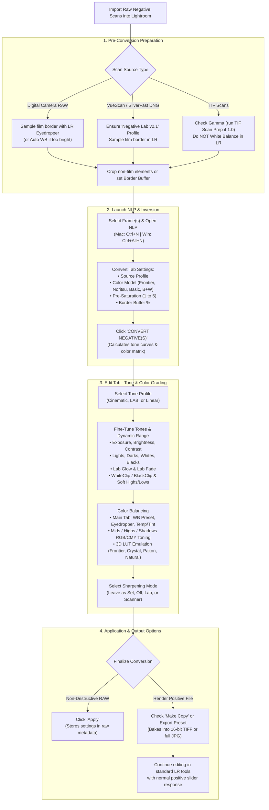

---

## 2. Preparing Your Negatives for Conversion

Once your negative scans are imported into Adobe Lightroom, complete the preparation steps specific to your scanning hardware before opening Negative Conversion Plugin.

### Pre-Conversion Decision Tree

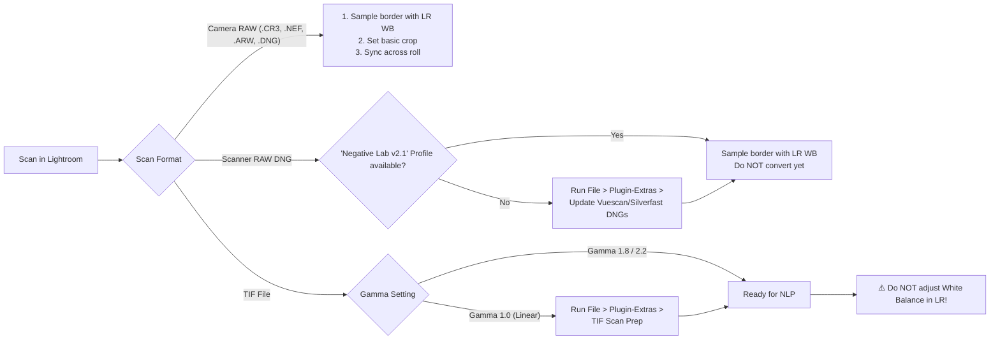

### Digital Camera Scans
1. **White Balance:** Before converting, use the White Balance selector (eyedropper) in Lightroom to sample off the unexposed film border. (You can do this once per roll and sync across photos.) If no film border is available, or if Lightroom warns that the area is too bright, select the **'Auto WB'** setting in Lightroom.
2. **Crop:** Exclude any non-film elements such as film holders or direct backlight edges. You can re-crop after conversion, or use the **Border Buffer** setting within Negative Conversion Plugin.

### VueScan / SilverFast RAW DNGs
1. **Profile Check:** Ensure that the **'Negative Lab v2.1'** raw camera profile is available. If it does not appear, go to `File > Plugin-Extras > Update Vuescan/Silverfast DNGs` (this can be batch-run across multiple DNG files at once). After running, the profile should show `Negative Lab v2.1`. If an error occurs, ensure all profiles from installation were copied correctly, restart Lightroom, and try again.
2. **White Balance:** Use Lightroom’s white balance selector to sample the film border (or use **'Auto WB'** if no border is visible or Lightroom rejects the sample).
3. **Crop:** Adjust your crop to exclude non-film elements, or rely on the Border Buffer.

### TIF Scans
1. **Gamma Calibration:**
   - If your scan is at **gamma 1.8** or **gamma 2.2** (recommended), proceed directly to step 2.
   - If your scan is **gamma 1.0**, first run the **TIF SCAN PREP** utility via `File > Plugin-Extras > TIF Scan Prep`. Proceed using the newly generated TIF file.
2. **No White Balance in LR:** **Do NOT** adjust white balance in Lightroom on TIF scans. Doing so will introduce severe color casts.
3. **Crop:** Adjust your crop or Border Buffer so non-film elements are excluded from the conversion analysis.

---

### Film Border Guidance & Pre-Conversion Tips

> [!TIP]
> **Including Film Border in Analysis:**  
> In select circumstances, you may achieve more accurate color results by including a small amount of the film border during conversion. If the photo was shot at box speed, or if the scene lacks any true black point, including a sliver of the unexposed emulsion helps calibrate shadows.  
> Because Negative Conversion Plugin is completely non-destructive, you can easily test this:
> 1. In NLP, click **"Unconvert"** and hit **"Apply"**.
> 2. Adjust your Lightroom crop to include a small strip of the border.
> 3. Reopen Negative Conversion Plugin, set **Border Buffer** to `0%`, and convert again.

> [!NOTE]
> **Lightroom Sync Feature:**  
> Speed up preparation by using Lightroom's internal **Sync** feature (`Cmd/Ctrl + Shift + S`) to sync white balance and crop across multiple frames from the same roll. If you scanned multiple film stocks, sample and sync borders separately for each stock.

---

## 3. Opening Negative Conversion Plugin

Once your negatives are prepared, select the image (or group of images) you wish to convert and launch the plugin.

### macOS
- **Shortcut:** `Ctrl + N`
- **Menu:** `File > Plug-in Extras > Negative Conversion Plugin`

### Windows
- **Menu:** `File > Plug-in Extras > Negative Conversion Plugin`
- **Windows Hotkey:** If running the background hotkey utility, use the shortcut matching your Lightroom language setting:

| Lightroom Language | Shortcut Key |
| :--- | :--- |
| **English** | `Ctrl + Alt + N` |
| **German** | `Ctrl + Alt + P` |
| **Swedish** | `Ctrl + Alt + N` |
| **Dutch (Netherlands)** | `Alt + N` |
| **French** | `Ctrl + Alt + X` |
| **Italian** | `Alt + Shift + X` |
| **Portuguese** | `Alt + X` |
| **Spanish** | `Alt + X` |

---

## 4. Conversion Settings (Convert Tab)

The **Convert** tab defines the initial mathematical translation from negative to positive. Negative Conversion Plugin requires these input parameters *before* analyzing the image and building tone curves.

### Convert Tab UI Mockup & Screenshot

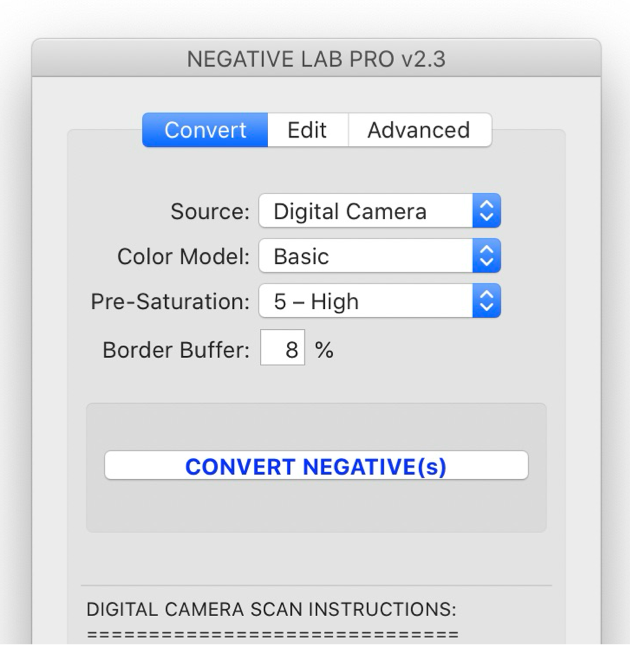

```
┌──────────────────────────────────────────────────────────────┐
│                    Negative Conversion Plugin v2.3                     │
├──────────────────────────────────────────────────────────────┤
│       [ Convert (Active) ]     [ Edit ]     [ Advanced ]     │
│  ┌────────────────────────────────────────────────────────┐  │
│  │                                                        │  │
│  │         Source: [ Digital Camera                     ⯆]│  │
│  │    Color Model: [ Basic                              ⯆]│  │
│  │ Pre-Saturation: [ 5 - High                           ⯆]│  │
│  │  Border Buffer: [ 8 ] %                                │  │
│  │                                                        │  │
│  │  ┌──────────────────────────────────────────────────┐  │  │
│  │  │                                                  │  │  │
│  │  │            [ CONVERT NEGATIVE(S) ]               │  │  │
│  │  │                                                  │  │  │
│  │  └──────────────────────────────────────────────────┘  │  │
│  │                                                        │  │
│  │  DIGITAL CAMERA SCAN INSTRUCTIONS:                     │  │
│  │  =================================                     │  │
│  │  1. Sample film border with LR WB selector.            │  │
│  │  2. Crop or set border buffer to exclude non-film.     │  │
│  │  3. Click 'CONVERT NEGATIVES' above.                   │  │
│  └────────────────────────────────────────────────────────┘  │
│                          [ Cancel ]            [ Apply ]     │
└──────────────────────────────────────────────────────────────┘
```

### Color Models
Color Models emulate the color balance and spectral characteristics of professional film lab scanners:

- **Basic:** A neutral color rendition. Ideal for color accuracy and users not seeking to emulate a specific commercial scanner aesthetic.
- **Frontier:** Emulates the classic **Fuji Frontier** scanner. Produces signature teal-blues, golden yellows, and warm skin tints widely associated with modern film photography.
- **Noritsu:** Emulates the **Fuji Noritsu** scanner. Shares many Frontier characteristics but with a cleaner, cooler, less pronounced warmth.
- **B+W:** Dedicated monochrome conversion mode. Use whenever converting black and white film negatives (or converting color negatives to monochrome).
- **NONE:** Disables all color model profiling and retains whatever profile was active before opening Negative Conversion Plugin. Ideal for custom camera profiles or unique color calibrations.

### Pre-Saturation
Pre-saturation modifies the saturation level of the raw negative *prior* to inversion. This directly influences the separation, vividness, and hue relationships in the converted positive:

- **Default Setting:** `3 - Default`
- **Lower Values (1–2):** Produces less color separation (fewer distinct visible hues), slightly warmer color tones, and lower vividness.
- **Higher Values (4–5):** Produces greater color separation (greater distinction between neighboring hues), slightly cooler color tones, and increased vividness.

### Border Buffer
Negative Conversion Plugin calculates conversion algorithms based on the pixels present within the image frame. If non-image elements (unexposed film border, film rebate, scanner masks, film carrier edges, or light flare) are visible, they distort the tonal analysis.

- **Border Buffer** specifies a percentage border margin (e.g., `5%` or `8%`) around the perimeter that the analysis engine will ignore.
- This eliminates the need to tightly crop negatives prior to conversion and re-expand the crop afterwards to show borders.
- *Rule of thumb:* If your film border occupies roughly 5% of the frame width/height, set Border Buffer to a value greater than 5%.

### Initiating the Conversion
Click the **"CONVERT NEGATIVE(s)"** button. Negative Conversion Plugin evaluates every pixel, separates channels, calculates color matrix transformations, maps optimal dynamic range curves, and writes analysis metadata directly into the image catalog.

---

## 5. Editing in Negative Conversion Plugin (Edit Tab)

The editing controls inside Negative Conversion Plugin are customized specifically for negative film chemistry and tone responses, functioning in ways Lightroom's native sliders cannot match on raw negatives.

### Full Edit Tab Interface Mockup & Screenshot

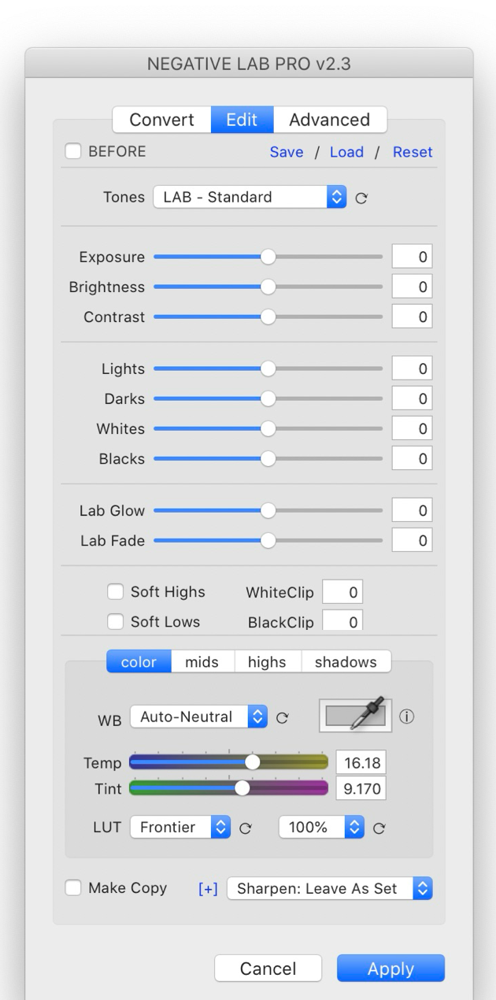

```
┌──────────────────────────────────────────────────────────────┐
│                    Negative Conversion Plugin v2.3                     │
├──────────────────────────────────────────────────────────────┤
│       [ Convert ]     [ Edit (Active) ]     [ Advanced ]     │
│                                                              │
│  [ ] BEFORE                         Save  /  Load  /  Reset  │
│                                                              │
│  ┌─ TONE CONTROLS ────────────────────────────────────────┐  │
│  │        Tones: [ LAB - Standard                     ⯆] ⟳│  │
│  │                                                        │  │
│  │     Exposure: [───●───────────────]  [  0 ]            │  │
│  │   Brightness: [────────●──────────]  [  0 ]            │  │
│  │     Contrast: [────────●──────────]  [  0 ]            │  │
│  │                                                        │  │
│  │       Lights: [────────●──────────]  [  0 ]            │  │
│  │        Darks: [────────●──────────]  [  0 ]            │  │
│  │       Whites: [────────●──────────]  [  0 ]            │  │
│  │       Blacks: [────────●──────────]  [  0 ]            │  │
│  │                                                        │  │
│  │     Lab Glow: [────────●──────────]  [  0 ]            │  │
│  │     Lab Fade: [────────●──────────]  [  0 ]            │  │
│  │                                                        │  │
│  │     [ ] Soft Highs        WhiteClip: [  0 ]            │  │
│  │     [ ] Soft Lows         BlackClip: [  0 ]            │  │
│  └────────────────────────────────────────────────────────┘  │
│                                                              │
│  ┌─ COLOR CONTROLS ───────────────────────────────────────┐  │
│  │   [ color ]    [ mids ]    [ highs ]    [ shadows ]    │  │
│  │                                                        │  │
│  │           WB: [ Auto-Neutral        ⯆] ⟳    [ 🖊 Eyedropper ]│
│  │         Temp: [═══Blue═══●═══Yellow═══]  [ 16.18 ]     │  │
│  │         Tint: [══Green═══●══Magenta═══]  [  9.17 ]     │  │
│  │          LUT: [ Frontier ⯆] ⟳   [ 100% ⯆] ⟳            │  │
│  └────────────────────────────────────────────────────────┘  │
│                                                              │
│  [ ] Make Copy      [+] Sharpen: [ Leave As Set         ⯆]   │
│                                                              │
│                          [ Cancel ]            [ Apply ]     │
└──────────────────────────────────────────────────────────────┘
```

### Non-Destructive Foundation
- All operations are completely non-destructive and reference the original raw negative.
- Because adjustments are applied at the base mathematical level rather than stacked as post-inversion adjustments, image fidelity is preserved with wide editing latitude.
- Edits can either be finalized within Negative Conversion Plugin or rendered into **Positive Copies** for further manipulation with Lightroom’s standard tools.

---

## 6. TONE Settings

### Tone Controls UI Mockup

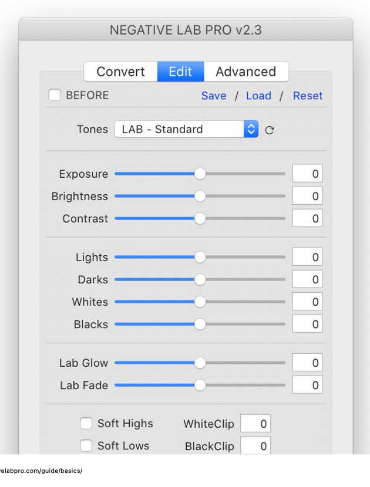

```
┌──────────────────────────────────────────────────────────────┐
│        Tones: [ LAB - Standard                     ⯆] ⟳      │
│                                                              │
│     Exposure: [───●───────────────]  [  0 ]  (Global exposure)│
│   Brightness: [────────●──────────]  [  0 ]  (Midtone gamma) │
│     Contrast: [────────●──────────]  [  0 ]  (S-curve slope) │
│                                                              │
│       Lights: [────────●──────────]  [  0 ]  (Upper midtones)│
│        Darks: [────────●──────────]  [  0 ]  (Lower midtones)│
│       Whites: [────────●──────────]  [  0 ]  (Highlight peak)│
│       Blacks: [────────●──────────]  [  0 ]  (Shadow floor)  │
│                                                              │
│     Lab Glow: [────────●──────────]  [  0 ]  (Smooth highs)  │
│     Lab Fade: [────────●──────────]  [  0 ]  (Lifted blacks) │
│                                                              │
│     [ ] Soft Highs        WhiteClip: [  0 ]                  │
│     [ ] Soft Lows         BlackClip: [  0 ]                  │
└──────────────────────────────────────────────────────────────┘
```

### Tone Profiles
Tone Profiles represent the starting point of your tonal rendering. As of v2.2, three core profile families are provided:

#### 1. CINEMATIC (`log // rich // flat`)
- **Characteristic:** Uses a logarithmic curve with the steepest gradient in highlights, leveling into low-contrast mid-tones and shadows.
- **Best Suited For:** Motion picture film stocks (CineStill, Kodak Vision3, Fuji Eterna) or any shot where a soft, moody, cinematic aesthetic is desired.

#### 2. LAB (`standard // soft // hard // highlight hard // highlight soft // shadow hard // shadow soft`)
- **Characteristic:** Emulates the punchy, high-contrast look of commercial minilab scanners. Employs auto-toning based on scene analysis, adds mid-tone punch, and slightly lifts blacks while lowering extreme whites to preserve headroom.
- **Best Suited For:** Portrait films such as Kodak Portra and Fuji 400H, delivering signature commercial "pop".

#### 3. LINEAR (`gamma // deep // flat`)
- **Characteristic:** A flat, linear relationship between white point and black point.
- **Variations:**
  - `Linear + Gamma`: Optimal baseline for all Black & White film stocks, calibrated to replicate classic silver gelatin darkroom paper response.
  - `Linear + Deep`: Excellent foundation for higher-contrast consumer film stocks (Kodak ColorPlus, Kodak Ektar, Fujicolor) or when building tonal grades completely from scratch.

---

### Fine-Tuning Tone Controls

| Control | Description & Operational Behavior |
| :--- | :--- |
| **Exposure** *(New in v2.3)* | Functions analogously to Lightroom's exposure slider; impacts brightest portions first while preserving tonal balance. |
| **Brightness** | Adjusts midtone brightness (gamma). Lowering increases image density and richness; raising creates an open, airy rendering. |
| **Contrast** | Adjusts midtone contrast slope, giving the image punch, definition, and apparent saturation. |
| **Lights** | Adjusts upper midtones and lighter values without clipping specular highlights. |
| **Darks** | Adjusts lower midtones and deeper values without altering black cutoff. |
| **Whites** | Adjusts the white point. *Note: Lowering whites softens highlights but does not un-clip data; use WhiteClip to restore clipped sensor data.* |
| **Blacks** | Adjusts the black point and shifts lower histogram regions. Pushing upward produces a faded matte look; pulling downward deepens shadows. *Note: Raising blacks will not restore crushed details; use BlackClip.* |
| **Lab Glow** *(New in v2.3)* | Compresses upper highlight tonality to produce silky, glowing highlights. Negative values expand highlight separation. |
| **Lab Fade** *(New in v2.3)* | Compresses deep shadows to create smooth, open blacks without pure ink black. Negative values expand shadow separation. |

---

### Controlling Dynamic Range

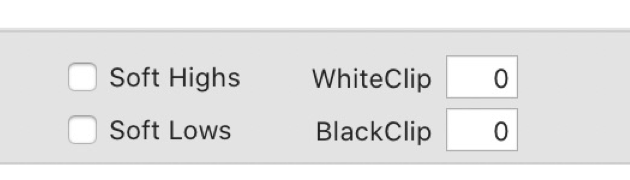

```
┌──────────────────────────────────────────────────────────────┐
│     [ ] Soft Highs        WhiteClip: [  0 ]                  │
│     [ ] Soft Lows         BlackClip: [  0 ]                  │
└──────────────────────────────────────────────────────────────┘
```

- **WhiteClip & BlackClip:** Defines the threshold where highlight and shadow values truncate into pure white or pure black. By default, Negative Conversion Plugin pins endpoints just before clipping occurs.
  - If a conversion displays blown highlight alerts, click the `WhiteClip` field and tap the **Down Arrow** (or input a negative integer) to recover headroom non-destructively.
- **Soft Highs & Soft Lows:** Applies a subtle tonal roll-off curve to the highlight and shadow shoulders, simulating the gentle highlight roll-off of analog photographic paper.

---

## 7. COLOR Settings

### Color Architecture & Processing Pipeline

The following diagram illustrates how color corrections flow through Negative Conversion Plugin's specialized color stages:

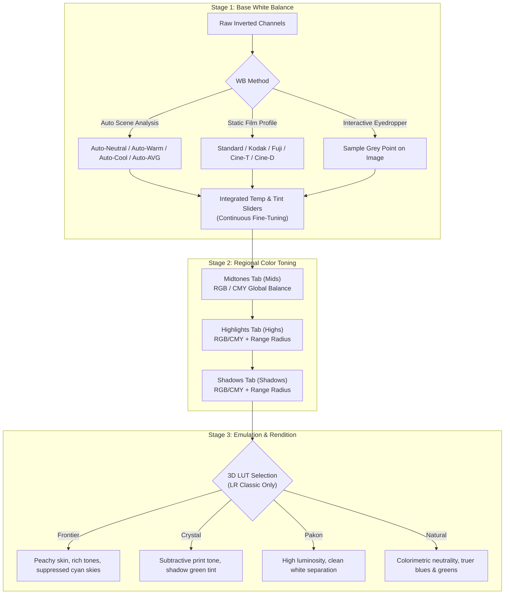

---

### The Main Color Tab & Temp/Tint Controls

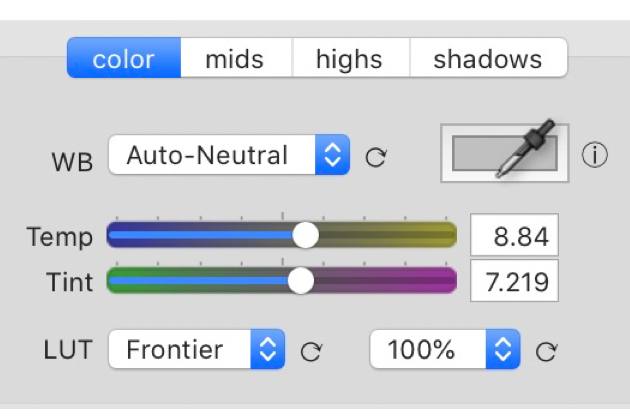

```
┌──────────────────────────────────────────────────────────────┐
│   [ color (Active) ]   [ mids ]   [ highs ]   [ shadows ]    │
│                                                              │
│           WB: [ Auto-Neutral        ⯆] ⟳    [ 🖊 Eyedropper ] ⓘ│
│         Temp: [═══Blue═══●═══Yellow═══]  [  8.84 ]           │
│         Tint: [══Green═══●══Magenta═══]  [  7.21 ]           │
│          LUT: [ Frontier ⯆] ⟳   [ 100% ⯆] ⟳                  │
└──────────────────────────────────────────────────────────────┘
```

The integrated **Temp / Tint** sliders feature an algorithm calibrated specifically for negative film characteristics:

> [!NOTE]
> **Technical Note on Film White Balance:**  
> Film white balancing differs fundamentally from digital sensor white balancing:  
> 1. In digital capture, WB compensates strictly for illuminant color temperature (e.g. warming a cool overcast sky).  
> 2. In film inversion, WB must simultaneously neutralize the orange film base mask and counter the conversion assumption of scene neutrality (that the brightest point is pure neutral white and darkest is pure neutral black).  
> 
> Consequently, **nearly 95% of film conversions require positive warmth added back in**. Zeroed Temp/Tint sliders will almost always appear unnaturally cold/cyan. Counter-intuitively, scenes captured under warmer physical lighting require **more** warmth added back during conversion to offset the mathematical neutral balance.

---

### White Balance Dropdown Options

Negative Conversion Plugin provides two categories of white balance presets:

#### Dynamic / Auto Options (Multi-Layer Scene Analysis)
- **Auto-Neutral (Default):** Locates neutral elements in the scene and aligns them to true neutral grey (similar to Photoshop’s neutral snap).
- **Auto-Warm:** Prioritizes identifying and eliminating blue/cyan base casts, yielding warmer tonal warmth.
- **Auto-Cool:** Actively suppresses warm or amber color casts.
- **Auto-AVG:** Averages total chromaticity equally across all three channels (legacy AutoColor 1.0; can skew if an image features strong dominant field colors).

#### Static Film Profiles (Empirical Tech Sheet Calibrations)
- **Standard:** Universal balance suited to varied film stocks.
- **Kodak:** Tuned to the spectral characteristics of Kodak color negative emulsions.
- **Fuji:** Tuned to the cooler green-cyan bias of Fujifilm color negative emulsions.
- **Cine-T:** Balanced for Tungsten-balanced motion picture stocks (e.g., Vision3 500T).
- **Cine-D:** Balanced for Daylight-balanced motion picture stocks (e.g., Vision3 250D).

---

### Color Picker Tool

The Color Picker samples a known neutral reference area (e.g., an 18% grey card or neutral concrete) to balance Temp and Tint instantly.

#### On macOS:
1. Click the **Color Picker icon** in Negative Conversion Plugin; the macOS System Color Tool appears.
2. Click the eyedropper icon on the macOS Color Tool (cursor changes).
3. Click the target neutral area on your negative image.
4. The Temp/Tint sliders in Negative Conversion Plugin will update. Fine-tune sliders as needed, or click the **"WB"** label to reset to zero.

#### On Windows:
1. Ensure GPU Acceleration is disabled in `Lightroom > Preferences > Performance` (*Graphics Processor* turned off).
2. Click and **drag** directly from the NLP Color Picker onto the image area you wish to sample (the cursor does not change appearance).
3. Hold the mouse button down over the sample point (NLP samples at 3-second intervals).
4. Release the mouse button when satisfied with the balance. Fine-tune using slider arrows.

---

### Mids / Highs / Shadow Color Toning

Color grading operates on opposing complementary color channels:
- **Red $\longleftrightarrow$ Cyan**
- **Green $\longleftrightarrow$ Magenta**
- **Blue $\longleftrightarrow$ Yellow**

#### Midtones Panel Mockup & Screenshot

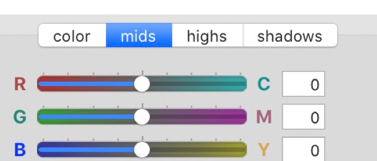

```
┌──────────────────────────────────────────────────────────────┐
│   [ color ]   [ mids (Active) ]   [ highs ]   [ shadows ]    │
│                                                              │
│        R [════════●════════] C  [  0 ]                       │
│        G [════════●════════] M  [  0 ]                       │
│        B [════════●════════] Y  [  0 ]                       │
└──────────────────────────────────────────────────────────────┘
```
- **Mids Tab:** Shifts global color balance across the middle tonal spectrum without displacing black or white anchor points.

#### Highlights & Shadows Panel Mockup & Screenshot

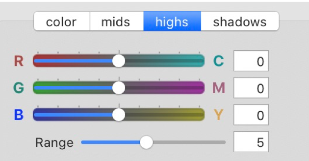

```
┌──────────────────────────────────────────────────────────────┐
│   [ color ]   [ mids ]   [ highs (Active) ]   [ shadows ]    │
│                                                              │
│        R [════════●════════] C  [  0 ]                       │
│        G [════════●════════] M  [  0 ]                       │
│        B [════════●════════] Y  [  0 ]                       │
│    Range [────────●────────]    [  5 ]                       │
└──────────────────────────────────────────────────────────────┘
```
- **Highs & Shadows Tabs:** Independent control over highlight and shadow colors. Useful for:
  - Correcting color casts in deep non-neutral shadows (e.g., deep forest greens rendered as dark magenta or cyan).
  - Warming skin tones or sunset skies in highlights without warming shadow values.
  - Replicating characteristic lab scanner shadow toning irregularities (e.g., Noritsu or Frontier shadow tones).
  - The **Range** slider determines the span of tones influenced by the adjustment.

---

### LUTs (Lightroom Classic Only)

> [!IMPORTANT]
> Requires Lightroom Classic 8.0+ and enhanced color profiles properly installed.

Negative Conversion Plugin v2.2+ embeds 3D Lookup Tables (LUTs) directly into the processing pipeline:

- **Natural:** Prioritizes colorimetric accuracy. Features true blues, natural foliage greens, and neutral skin reproduction.
- **Frontier:** Emulates the classic Fuji Frontier aesthetic. Produces richer saturation, purer neutral highlights, warmer peachy skin tones, clean sky greens/yellows, and suppressed cherry reds.
- **Crystal:** Emulates traditional Fuji Crystal Archive photographic paper. Delivers subtractive print-style tonality with deep contrast and a subtle green bias in deep shadows.
- **Pakon:** Emulates the Pakon F135 scanner. Characterized by high-key luminous contrast, clean channel separation, and bright whites.

---

## 8. Sharpening

Negative Conversion Plugin features customized sharpening algorithms tailored to film grain structure:

- **Sharpen: Leave as Set (Default, v2.1+):** Leaves sharpening settings under direct user/Lightroom control without overriding existing values.
- **Sharpen: Off:** Zeroes out all sharpening and noise reduction. Ideal for scans pre-sharpened during hardware scanning.
- **Sharpen: Lab:** Emulates Fuji Frontier lab sharpening. Applies soft, edge-targeted sharpening with an intelligent mask that suppresses grain amplification, flattering portrait skin tones.
- **Sharpen: Scanner:** Emulates gritty, high-texture scanning. Emphasizes grain and texture; popular for street photography, documentary work, and gritty black-and-white images.

---

## 9. Saving Your Default Settings

To establish personal presets as default settings:
1. Configure your preferred settings (e.g., Tone Profile: `Cinematic - Rich`, White Balance: `AutoWarm`, Border Buffer: `5%`).
2. Click the **Save** command located at the top of the NLP panel.
3. Every subsequent conversion will initialize with your saved configuration.

---

## 10. Positive Copies

### Why Use Positive Copies
Because Lightroom’s standard sliders (Exposure, Highlights, Shadows, White Balance) are designed for normal camera raw files, applying them to an inverted negative produces reversed or non-linear behavior. 

A **Positive Copy** bakes the Negative Conversion Plugin inversion into a rendered positive file (TIFF or JPEG) and imports it into your Lightroom catalog. On a positive copy, every native Lightroom tool functions exactly as expected.

*Recommendation: Strive to achieve as much of your look as possible within Negative Conversion Plugin first to benefit from raw headroom, creating positive copies only when specialized local Lightroom brushes, radial filters, or export workflows require them.*

### Creating a Positive Copy

#### Method 1: Directly inside Negative Conversion Plugin
- Check the **"Make Copy"** checkbox in the NLP interface.
- When you click **Apply**, NLP processes the frame and automatically exports and catalogs the positive copy.
- Configure positive copy formatting under the **Advanced** tab.

#### Method 2: Batch Export from Lightroom Grid
- Select one or more converted frames in Lightroom's Library grid.
- Right-click and choose `Export > NLP - Positive TIFF Copy`.
- To customize export presets (naming conventions, subfolder destination, bit depth), open `File > Export`, select the preset under the left column, make adjustments, and save.

### Troubleshooting Positive Copies
- If **Placement** is set to **Stack**, positive copies are stacked alongside original negatives. Stacks are visible only within specific folder views and **will not appear** in special catalog collections such as "Previous Import".

---

## 11. Advanced Options (Advanced Tab)

The **Advanced** tab provides fine-grained control over the underlying mathematics and rendering pipeline.

### Advanced Tab Interface Mockup & Screenshot

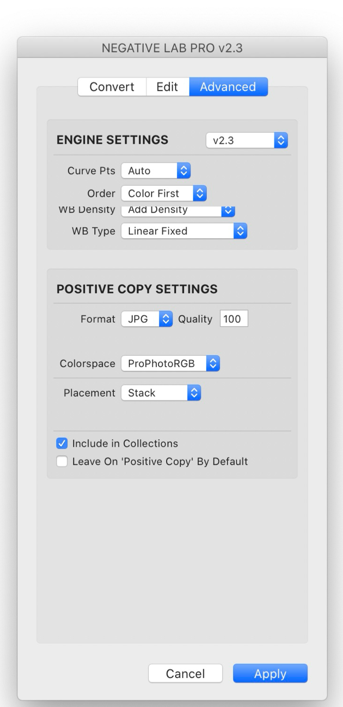

```
┌──────────────────────────────────────────────────────────────┐
│                    Negative Conversion Plugin v2.3           │
├──────────────────────────────────────────────────────────────┤
│       [ Convert ]     [ Edit ]     [ Advanced (Active) ]     │
│                                                              │
│  ┌─ ENGINE SETTINGS ──────────────────────────────────────┐  │
│  │   ENGINE SETTINGS: [ v2.3                            ⯆]│  │
│  │                                                        │  │
│  │         Curve Pts: [ Auto                            ⯆]│  │
│  │             Order: [ Color First                     ⯆]│  │
│  │        WB Density: [ Add Density                     ⯆]│  │
│  │           WB Type: [ Linear Fixed                    ⯆]│  │
│  └────────────────────────────────────────────────────────┘  │
│                                                              │
│  ┌─ POSITIVE COPY SETTINGS ───────────────────────────────┐  │
│  │            Format: [ JPG ⯆]        Quality: [ 100 ]    │  │
│  │        Colorspace: [ ProPhotoRGB                     ⯆]│  │
│  │         Placement: [ Stack                           ⯆]│  │
│  │                                                        │  │
│  │   [✔] Include in Collections                           │  │
│  │   [ ] Leave On 'Positive Copy' By Default              │  │
│  └────────────────────────────────────────────────────────┘  │
│                                                              │
│                          [ Cancel ]            [ Apply ]     │
└──────────────────────────────────────────────────────────────┘
```

### Engine Settings & Curve Points
- **Engine Version:** Allows toggling between the current v2.3 engine, v2.2, or legacy v2.1/earlier engines to ensure backward consistency across historical catalogs.
- **Curve Points:** Controls the density of control points plotted on Lightroom's RGB tone curves:
  - **Auto (Default):** Dynamically allocates points based on image tonal evaluation for optimal smoothness and fidelity.
  - **Smooth:** Constrains the curve to 4 points. Delivers ultra-smooth gradients and responsive adjustment, with limited extreme tonal range.
  - **Precise:** Uses up to 14 control points for granular tonal control. In rare instances of harsh transitions, slight posterization may occur.
  - **Manual:** Lets you define between 2 and 14 curve points. *(Note: setting fewer than 4 points disables certain secondary sliders).*

### Processing Order
- **Colors First (Recommended):** Evaluates color balancing before tone curves. Color remains rock-solid while you manipulate exposure and contrast.
- **Tones First (Historic):** Calculates tonal contrast prior to color balance (matches NLP v2.1 and earlier). May cause color shifts when making tonal edits.

### WB Density & WB Type
- **WB Density:** Determines how white balance modifications influence image luminance:
  - **Add Density:** Adding yellow or magenta makes the image slightly denser/darker (mimicking photographic print exposure).
  - **Neutral Density:** Luminance remains unchanged regardless of color shifts (easiest for editing).
  - **Subtract Density:** Adding yellow or magenta slightly brightens luminance (mimics Lightroom native WB).
- **WB Type:** Algorithms controlling how color adjustments are distributed along the tone curve:
  - **Linear Fixed (Default):** Evenly distributes color balance across the full tonal range while pinning absolute black and white points.
  - **Linear Dynamic:** Shifts color balance across the entire tonal range, including black and white points.
  - **Midtone Weighted:** Focuses color shifts predominantly within midtones.
  - **Highlight Weighted:** Focuses color adjustments predominantly in highlight values.
  - **Shadow Weighted:** Focuses color adjustments predominantly in shadow values.

### Positive Copy Settings
- **Format:** Choose between `TIF` (lossless archive) or `JPG` (lightweight delivery).
- **Bits (TIF only):** `16-bit` (maximum latitude) or `8-bit`.
- **Compression (TIF only):** `Lossless ZIP` or `None`.
- **Quality (JPG only):** Slider from `0` to `100`.
- **Colorspace:**
  - `sRGB`: Standard for web display and digital sharing.
  - `AdobeRGB`: Standard for fine art printing and commercial lab output.
  - `ProPhotoRGB`: Native Lightroom wide-gamut space for continued raw editing.
- **Placement:** Select `Stack` (stacks next to original raw negative) or `Subfolder`.
- **Include in Collections:** Automatically appends created positive copies to any active Lightroom collection.
- **Leave On 'Positive Copy' By Default:** Keeps positive copy generation enabled across all future sessions.

---

## 12. Workflow Tips & Tricks

- **Single-Click Reset:** Single-click any slider label (e.g., click the word *"Brightness"*) to reset that parameter instantly to zero.
- **Cycle Dropdown Button ($\mathbf{\circlearrowright}$):** Click the small circular cycle button next to dropdown menus to rapidly cycle through options without expanding the full list.
- **Tooltip Previews:** Hover your cursor over slider titles (such as *"Tones"*) to display a detailed tooltip explaining that feature.
- **Arrow Key Accuracy:** Click directly inside any numeric parameter box and use the **Up** and **Down** arrow keys to make micro-adjustments. Hold **Shift** while pressing arrow keys for larger incremental steps.
- **Keyboard Navigation:** Use **Tab** and **Shift + Tab** to jump consecutively forward and backward between numeric input fields.
- **Slider Limit Override:** If a slider reaches its default UI limit (for example, the Brightness slider capping at 30), click the numeric field and type a higher value manually (e.g., `50`).

---

## 13. Additional Guides & Resources

For in-depth tutorials, community support, and specialized workflows:

- **Knowledge Base:**
  - Installing & Setup
  - Scanning Best Practices (DSLR / Mirrorless Camera Scanning & Flatbed Scanning)
  - Batch Processing Workflows
  - Dedicated Black & White Film Inversion
  - Film Metadata Utility Guide
  - Lightroom Integration Tips
- **Troubleshooting & Support:**
  - Resolving Inversion Artifacts & Color Casts
  - Troubleshooting Camera RAW Profiles
  - Creating Raw DNG Files with VueScan and SilverFast
  - Serial Number & License Recovery
- **Community Forums:**
  - Backlight Sources Guide & Spectral Comparisons
  - Dedicated Epson Scanner Workflows
  - DSLR/Mirrorless Film Scanning Setups & Hardware Reviews
- **Connect:**
  - Official Website: [negativelabpro.com](https://www.negativelabpro.com/)
  - Community Forum: [forums.negativelabpro.com](https://forums.negativelabpro.com/)
